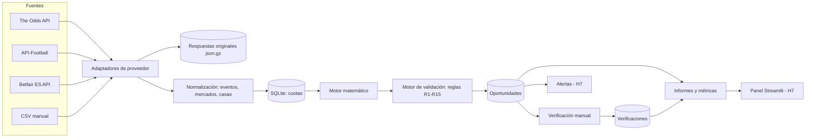

# SURE BETTING — Fase 0: investigación, viabilidad y arquitectura

**Versión:** 1.0 · **Fecha de consulta de todas las fuentes:** 15/10/2026 · **Estado:** propuesta para revisión (no hay código de la aplicación)

Este documento responde a una pregunta: **qué construir, con qué datos, qué se puede hacer gratis y qué no**, para una herramienta personal de detección de arbitrajes deportivos orientada al mercado español.

## Cómo leer las etiquetas

| Etiqueta | Significado |
|---|---|
| **[V]** | Hecho verificado en fuente oficial o reproducido con datos y código en este repositorio. |
| **[V\*]** | Verificado en un extracto de la fuente o en una fuente secundaria (blog, reseña, competidor). Puede haber cambiado. |
| **[E]** | Estimación propia con los supuestos indicados. |
| **[H]** | Hipótesis razonable que todavía no he podido comprobar. |
| **[PT]** | Requiere una prueba técnica. Indico en qué hito se resuelve. |

Las referencias entre corchetes ([1], [2]…) remiten al [Anexo A](#anexo-a-fuentes-consultadas).

**Limitación de esta investigación.** Desde el entorno en el que trabajé, la navegación directa a webs estaba bloqueada. Verifiqué con un buscador que devuelve extractos de las páginas (incluidas las oficiales) y descargué datos reales desde réplicas en GitHub y PyPI. Por eso uso [V\*] cuando el dato viene de un extracto o de un tercero, y dejo como [PT] lo que hay que confirmar con una llamada real a la API. Ninguna cifra de este documento está inventada; cuando dos fuentes discrepan, lo indico.

---

## Índice

1. [Resumen ejecutivo](#1-resumen-ejecutivo)
2. [Cómo funciona realmente el sure betting](#2-cómo-funciona-realmente-el-sure-betting)
3. [Comparativa de deportes y mercados](#3-comparativa-de-deportes-y-mercados)
4. [Mapa de proveedores de cuotas](#4-mapa-de-proveedores-de-cuotas)
5. [Matriz de disponibilidad gratuita](#5-matriz-de-disponibilidad-gratuita)
6. [Estrategia de datos históricos](#6-estrategia-de-datos-históricos)
7. [Arquitectura recomendada](#7-arquitectura-recomendada)
8. [Necesidad real de modelos predictivos y agentes](#8-necesidad-real-de-modelos-predictivos-y-agentes)
9. [Modelo matemático y reglas de validación](#9-modelo-matemático-y-reglas-de-validación)
10. [Riesgos operativos y controles](#10-riesgos-operativos-y-controles)
11. [Presupuesto y límites de gratuidad](#11-presupuesto-y-límites-de-gratuidad)
12. [Plan de desarrollo por fases](#12-plan-de-desarrollo-por-fases)
13. [Criterios de aceptación del MVP](#13-criterios-de-aceptación-del-mvp)
14. [Decisiones pendientes](#14-decisiones-pendientes)
15. [Recomendación final](#15-recomendación-final)
- [Anexo A. Fuentes consultadas](#anexo-a-fuentes-consultadas)
- [Anexo B. Pruebas técnicas realizadas](#anexo-b-pruebas-técnicas-realizadas)
- [Anexo C. Reglas propuestas para trabajar con Claude Code](#anexo-c-reglas-propuestas-para-trabajar-con-claude-code)
- [Anexo D. Glosario](#anexo-d-glosario)

---

## 1. Resumen ejecutivo

**La respuesta corta.** Con 0 € se puede construir una herramienta que detecte candidatos a surebet y **mida si son reales**, pero no un escáner automático en tiempo real entre casas españolas. El cuello de botella no es la matemática ni el software: son los datos de las webs `.es`.

### Lo que he encontrado

1. **La matemática es sencilla y determinista.** Hay arbitraje cuando la suma de los inversos de las mejores cuotas de todos los resultados es menor que 1 (`S < 1`). El retorno teórico es `1/S − 1`. Todos los ejemplos de este documento están recalculados con aritmética decimal exacta [V].

2. **Ninguna fuente gratuita y autorizada cubre de forma automática las casas con licencia de la DGOJ en sus dominios `.es`.**
   - **The Odds API** (gratis: 500 créditos al mes) cubre marcas internacionales como William Hill, 1xBet, Betsson, Winamax (Francia/Alemania), LeoVegas (Suecia) o el exchange internacional de Betfair [V\*]. Varias de esas marcas tienen licencia en España con otra sociedad y otro dominio, pero **sus cuotas `.es` pueden no coincidir** [H → PT en H2].
   - **API-Football** (gratis: 100 peticiones al día) da cuotas prepartido que, según su propia guía, se actualizan cada 3 horas [V\*]. Sirve para contrastar, no para cazar arbitrajes que duran minutos.
   - **Betfair Exchange** es la única API oficial que he encontrado de un operador con licencia española (betfair.es). La clave de desarrollo es gratuita y entrega precios con un retraso de 1 a 180 segundos; la clave en tiempo real cuesta 499 £ de pago único [V\*].
   - **Odds-API.io** sí publica versiones españolas (Bwin ES, Codere ES, Retabet ES, Luckia ES, PokerStars ES…), pero **ha pausado las claves gratuitas** y su plan más barato cuesta 49 £/mes con 2 casas [V\*].
   - **Flashscore y OddsPortal** (ambos de Livesport) no ofrecen API pública y su uso automatizado choca con sus condiciones [V\*].

3. **Consecuencia práctica.** El producto viable con 0 € es un sistema de **detección + verificación**: las APIs gratuitas generan candidatos, tú compruebas las cuotas en las webs `.es` y el sistema registra todo con sus tiempos. Ese registro (cuotas que seguían disponibles al verificar) no existe en ninguna parte y es lo que te dirá si merece la pena seguir.

4. **Deporte inicial: fútbol prepartido** (1X2 y más/menos de 2,5 goles en LaLiga y Premier League). Puntuación ponderada 4,30/5 frente a 3,15 de tenis y de baloncesto. El directo queda fuera del MVP (2,05/5).

5. **Arquitectura:** Python + SQLite + línea de comandos, con proveedores de datos intercambiables. Streamlit solo cuando haya datos que enseñar. Sin modelos predictivos ni agentes de IA en el camino crítico.

6. **Lo que dicen los datos reales (pruebas del Anexo B):**
   - En **211.210 partidos de fútbol** (2005-2026), combinar la cuota máxima de mercado de unas 17 casas europeas daba `S < 1` en el **22,7%** de los partidos (32% en LaLiga) [V]. Parece una mina. No lo es: son cuotas de casas distintas tomadas en momentos distintos, la mayoría sin licencia en España, y hay **147 partidos con retornos aparentes de más del 11%** que son errores de datos.
   - En **304.824 partidos de tenis** (2019-2026), el **3,0%** acaba en retirada y el **77%** de esas retiradas llega con al menos un set completado [V]. bet365 anula la apuesta si el partido no se completa [V]; Betfair Sportsbook la mantiene si se completó el primer set [V\*]. En ese escenario, un surebet de 100 € combinando ambas pasa a ganar o perder **51,22 €**.

7. **Regulación nueva que te afecta.** El Real Decreto 520/2026 crea un **límite de depósito conjunto para todos los operadores**: 700 €/día, 1.750 €/semana y 3.300 € cada 4 semanas por defecto, modificables a petición del jugador [V][37]. Se aplicará cuando la DGOJ ponga en marcha el registro central; una fuente lo sitúa en marzo de 2027 [V\*][38]. El arbitraje exige saldo repartido entre varias casas, así que este límite afecta directamente a la operativa real.

8. **El mayor riesgo a medio plazo no es técnico: es la limitación de cuentas.** Los autores de un conocido estudio académico sobre ganar a las casas con sus propias cuotas dejaron de apostar porque les bloquearon las cuentas [V][49].

9. **Cuestiono un supuesto.** Si el objetivo fuera ganar dinero pronto, tu propio escáner con datos gratuitos no compite con los escáneres comerciales, que ya tienen versiones gratuitas (limitadas a surebets de hasta el 1% y con retraso) [V\*]. Tu herramienta tiene sentido como **sistema propio de medición, verificación y aprendizaje**, y como base objetiva para decidir si pagar datos o no.

### Qué recomiendo construir

H1 calculadora verificable → H2 captura real con The Odds API → H3 detección → H4 verificación manual → H5 Betfair ES + segunda fuente → H6 estudio de 4 semanas y decisión. Todo con coste 0 €. El detalle está en la [sección 12](#12-plan-de-desarrollo-por-fases).

### Qué no recomiendo

- Directo (in-play) en el MVP.
- Scraping de webs de casas o de comparadores.
- Agentes de IA para calcular, validar o completar datos.
- Diseñar pantallas antes de tener cuatro semanas de datos.

---

## 2. Cómo funciona realmente el sure betting

### 2.1 Qué es un surebet

Cada casa fija sus cuotas con un margen a su favor. Si eliges, para cada resultado posible de un mismo mercado, la mejor cuota disponible entre varias casas, y la suma de probabilidades implícitas de esas cuotas queda por debajo del 100%, puedes repartir el dinero de forma que cobres lo mismo pase lo que pase. Eso es un arbitraje o *surebet*. No hace falta acertar nada: el beneficio sale de la diferencia de precios entre casas.

### 2.2 Probabilidad implícita y margen de la casa

La probabilidad implícita de una cuota decimal `c` es `p = 1/c`.

**Ejemplo 1 — mercado a dos opciones, 1,90 / 1,90** [V]: `1/1,90 + 1/1,90 = 105,26%`. El 5,26% que sobra es el margen (*overround*) de la casa.

**Ejemplo 2 — 1X2 con 2,30 / 3,30 / 3,20** [V]: probabilidades implícitas 43,48% + 30,30% + 31,25% = 105,03% → margen del 5,03%. Si se reparte el margen de forma proporcional, la probabilidad "justa" sería 41,40% / 28,85% / 29,75%. Quitar el margen así es útil para el *value betting*; para el arbitraje no hace falta.

Referencia real: el margen mediano de bet365 en 1X2 entre 2022 y 2024 fue del 4,19% en la Premier League, 4,43% en LaLiga y 6,84% en Segunda División, según los datos de football-data.co.uk [V] (Anexo B, prueba B1).

### 2.3 Cómo se detecta una oportunidad

Para un mercado con `n` resultados mutuamente excluyentes y exhaustivos:

```
S = Σ 1/c_i        (c_i = mejor cuota disponible para el resultado i)
Hay arbitraje si S < 1
Retorno teórico R = 1/S − 1
```

**Ejemplo 3 — tenis, dos opciones** [V]: Jugador A a 2,10 en la casa X y Jugador B a 2,00 en la casa Y. `S = 0,476190 + 0,500000 = 0,976190` → **R = 2,439%**.

**Ejemplo 4 — fútbol 1X2** [V]: local a 2,45 en X, empate a 3,60 en Y, visitante a 3,40 en Z. `S = 0,980059` → **R = 2,035%**.

**Sobre la regla de "la cuota debe superar 2,00".** En un arbitraje de dos opciones, al menos una cuota tiene que ser mayor que 2,00, porque si ambas son ≤ 2,00 la suma de inversos ya es ≥ 1. En uno de `n` opciones, al menos una cuota supera `n`. Es una **consecuencia** de `S < 1`, no un filtro. Exigir que cada cuota supere 2,00 descartaría arbitrajes válidos sin ganar nada a cambio: un 1X2 con el favorito a 1,65, el empate a 4,50 y el visitante a 6,50 da `S = 0,982129`, un 1,82% de retorno [V].

### 2.4 Reparto óptimo de las apuestas

Para cobrar lo mismo en cualquier resultado con una banca total `B`:

```
apuesta_i = B × (1/c_i) / S
pago (cualquier resultado) = B / S
beneficio = B/S − B = B × R
```

- **Ejemplo 3 con 100 €** [V]: 48,78 € al Jugador A y 51,22 € al Jugador B. Cobras 102,44 € gane quien gane.
- **Ejemplo 4 con 100 €** [V]: 41,65 € / 28,34 € / 30,01 €. Cobras 102,03 €.

Existe la variante de concentrar el beneficio en un solo resultado (beneficio cero en los demás). Matemáticamente es válida, pero cambia el perfil de riesgo. El MVP usará el reparto de pago igual.

### 2.5 De dónde salen los surebets (y de dónde salen los falsos)

Los arbitrajes reales aparecen por diferencias de opinión entre casas, casas que actualizan tarde tras una noticia (alineaciones, lesiones), cuotas promocionales y errores. Los **falsos** salen de comparar mercados que parecen iguales y no lo son, de cuotas antiguas y de errores de datos. En un sistema automático los falsos positivos son mucho más frecuentes que los arbitrajes reales [H, coherente con la prueba B1: 147 casos con retorno aparente > 11%].

### 2.6 Comisiones

En un *exchange* (Betfair) se paga comisión sobre la **ganancia neta** de cada mercado. Para residentes en España la tasa base de Betfair es del **2%** [V\*][16] (para otros mercados se suele citar un 5% [H]; lo uso solo como comparación).

La cuota efectiva de una apuesta a favor (*back*) con comisión `k` es:

```
c_efectiva = 1 + (c − 1) × (1 − k)
2,10 con k = 2% → 2,078        2,10 con k = 5% → 2,045        [V]
```

**Arbitraje back/lay** (a favor en una casa y en contra en el exchange). Con cuota a favor `B`, cuota en contra `L` y comisión `k`:

```
apuesta_lay = apuesta_back × B / (L − k)
responsabilidad (lo que arriesgas en el exchange) = apuesta_lay × (L − 1)
hay arbitraje si B × (1 − k) > L − k
```

**Ejemplo 5** [V]: a favor a 2,20 con 100 € y en contra a 2,10.

| Comisión | Apuesta lay | Responsabilidad | Beneficio en ambos casos | Sobre la apuesta | Sobre el capital inmovilizado |
|---|---|---|---|---|---|
| 2% (España) | 105,77 € | 116,35 € | 3,65 € | 3,65% | 1,69% |
| 5% | 107,32 € | 118,05 € | 1,95 € | 1,95% | 0,89% |

Fíjate en la última columna: la rentabilidad sobre el dinero que realmente tienes bloqueado es menos de la mitad de la que parece.

Otros costes posibles: comisiones de depósito o retirada según el método de pago y posibles cargos adicionales del exchange [PT: confirmar en betfair.es en H5].

### 2.7 Redondeo

Las casas suelen aceptar céntimos [H, a confirmar por casa en PT-8], pero apostar importes como 48,78 € es un patrón muy reconocible y en la práctica se redondea. El redondeo cuesta dinero y puede convertir un arbitraje en una pérdida segura [V]:

| Caso | Importes | Beneficio mínimo garantizado |
|---|---|---|
| Ejemplo 3, sin redondeo | 48,78 / 51,22 | 2,44 € (2,44%) |
| Ejemplo 3, redondeo a 1 € | 49 / 51 | 2,00 € (2,00%) |
| Ejemplo 3, redondeo a 5 € | 50 / 50 | 0,00 € (0,00%) |
| Ejemplo 4, redondeo simple a 1 € | 42 / 28 / 30 | 0,80 € (0,80%) |
| Ejemplo 4, **redondeo optimizado** a 1 € | 41 / 28 / 30 (total 99 €) | 1,45 € (1,46%) |
| Ejemplo 4, redondeo a 5 € (mejor combinación) | 45 / 30 / 35 | **−2,00 € (pérdida)** |

Conclusión de diseño: el motor no debe redondear "a ojo"; debe buscar la combinación de importes redondeados que maximiza el beneficio mínimo, y recalcular el retorno **después** de redondear. También hay apuestas mínimas por casa [PT por casa].

### 2.8 Arbitraje, value betting y apuestas predictivas

| | Arbitraje | Value betting | Apuesta predictiva |
|---|---|---|---|
| Qué buscas | `S < 1` combinando casas | Una cuota mayor que la probabilidad "justa" estimada (con una casa de referencia o el consenso del mercado) | Una probabilidad propia mejor que la del mercado |
| Riesgo por evento | Nulo en teoría, si todo se ejecuta y se liquida igual | Alto: pierdes muchas apuestas sueltas | Alto |
| ¿Necesita modelo? | No | Sí, aunque sea el consenso del mercado | Sí, propio |
| Cómo se valida | Ejecutabilidad: ¿seguía la cuota?, ¿se liquida igual? | Cientos de apuestas, rentabilidad a largo plazo, *closing line value* | Backtesting fuera de muestra y calibración |
| Riesgo de limitación | Alto | Alto | Medio-alto si ganas |

El estudio de Kaunitz, Zhong y Kreiner (2017) es de *value betting* (apostar a cuotas que se desvían del promedio del mercado), no de arbitraje. Lo cito por la parte operativa: tras ganar, las casas les limitaron, y en su repositorio escriben que apostarían por sus recomendaciones "si las casas no nos hubieran bloqueado las cuentas" y que el esfuerzo "no compensa" por el tiempo y la recompensa [V][49].

### 2.9 Rentabilidad teórica frente a beneficio conseguido

Conviene separar tres números y no mezclarlos nunca:

1. **Retorno teórico:** `1/S − 1` con las cuotas capturadas por la fuente de datos.
2. **Retorno verificable:** el mismo cálculo con cuotas comprobadas en las webs `.es`, después de comisiones y redondeo.
3. **Beneficio conseguido:** lo que queda después de ejecutar, liquidar (incluidas anulaciones), pagar comisiones de pago e impuestos, y medido sobre el capital inmovilizado y el tiempo.

Lo que separa el primero del tercero:

- **La cuota cambia** entre que la ves y apuestas.
- **La casa limita** el importe o rechaza la apuesta.
- **Errores palpables:** las condiciones de las casas suelen permitir anular apuestas hechas a cuotas manifiestamente erróneas [H: cláusula habitual; revisar en las condiciones de cada casa].
- **Reglas de liquidación distintas** (2.11).
- **Mercado suspendido** mientras completas la segunda pata.
- **Limitación de cuentas** tras detectar el patrón.
- **Capital y depósitos:** dinero repartido en muchas casas, plazos de retirada y, desde la entrada en vigor del RD 520/2026, un límite conjunto de depósito [V][37].
- **Impuestos:** en el IRPF, las ganancias del juego tributan en la base general por el neto anual; las pérdidas del año solo compensan ganancias del juego del mismo año y hasta su importe [V\*][39]. Un 2% bruto con un tipo marginal del 30% se queda en un 1,40% neto [E].
- **Errores humanos:** mercado equivocado, importe mal tecleado.

### 2.10 Cuotas que cambian y límites de apuesta

**Ejemplo 6 — la cuota cae después de colocar la primera pata** [V]. Ya has apostado 51,22 € al Jugador B a 2,00. Si la cuota de A cae antes de cubrir:

| Nueva cuota de A | Importe para cubrir | Resultado garantizado |
|---|---|---|
| 2,10 (sin cambio) | 48,78 € | +2,44 € (2,44%) |
| 2,05 | 49,97 € | +1,25 € (1,23%) |
| 2,02 | 50,71 € | +0,51 € (0,50%) |
| 2,00 | 51,22 € | 0,00 € |
| 1,95 | 52,53 € | −1,31 € (−1,27%) |
| 1,90 | 53,92 € | −2,70 € (−2,56%) |

Una bajada de pocos céntimos se come el margen. Por eso se coloca primero la pata con más probabilidad de moverse (la cuota "fuera de mercado") y el umbral mínimo tiene que absorber el deslizamiento típico.

**Ejemplo 7 — límite de apuesta** [V]. Si la casa X solo acepta 30 € en el Jugador A, toda la operación queda limitada a 61,50 € (30 € + 31,50 €) y el beneficio a 1,50 €.

### 2.11 Anulaciones asimétricas: cuando una apuesta se anula y la otra sigue

Es el riesgo más traicionero, porque convierte una posición cubierta en una apuesta abierta.

**Tenis.** Las casas aplican reglas distintas cuando un jugador se retira:

| Casa | Regla documentada | Nivel |
|---|---|---|
| bet365 | Si el partido empieza y no se completa, las apuestas se anulan (salvo mercados ya decididos; en caso de descalificación, gana quien pasa de ronda) | [V][41] |
| Betfair Sportsbook | Anula si la retirada llega antes de terminar el primer set; después, gana quien pasa de ronda. En ITF, UTR y exhibiciones anula siempre | [V\*][43] |
| Bwin | Según una guía de terceros: tras el primer set, gana el rival; antes, se anula | [V\*][45] |
| Codere, Sportium, William Hill | Las fuentes secundarias se contradicen [45] | [PT] |

**Ejemplo 8** [V]: 48,78 € a A en bet365 (anula si no se completa) y 51,22 € a B en una casa con regla de "un set". Si A se retira tras el primer set: bet365 devuelve 48,78 € y la otra casa paga 102,44 € → **+51,22 €**. Si se retira B: bet365 devuelve 48,78 € y pierdes los 51,22 € → **−51,22 €**. Ya no hay arbitraje.

¿Con qué frecuencia? En los datos de 2019-2026, el 2,27% de los partidos del circuito ATP principal y el 2,43% del WTA terminan en retirada **después** de completar al menos un set [V] (Anexo B, prueba B2). Con 50 surebets de tenis de 2,44 € cada uno, sin este riesgo ganarías 122 €. Si los 50 combinan casas con reglas distintas, la media apenas cambia (119 €), pero en el 5% de los escenarios peores te quedas en 14,70 € o menos [E, simulación B3, suponiendo que cualquiera de los dos jugadores tiene la misma probabilidad de retirarse]. Rompe la idea de "seguro".

**Fútbol.** Partidos aplazados: bet365 considera "no participante" un partido que no se juega en los 5 días siguientes a la fecha original [V][42]; para Codere, fuentes de terceros hablan de "la misma semana natural" o de 48 horas [V\*][44]. Un aplazamiento de 3 días puede dejar una pata viva en bet365 y la otra anulada en Codere.

**Baloncesto.** "Ganador del partido" suele incluir la prórroga; "1X2 a tiempo reglamentario" tiene empate como tercera opción [V\*][46]. Combinarlos como si fueran el mismo mercado es un falso arbitraje.

**Control:** el sistema guardará la regla de cada casa por deporte (con fuente y fecha) y **solo** aceptará combinaciones de casas con la misma regla. Si la regla de alguna casa es desconocida, la oportunidad no se considera verificable.

### 2.12 Mercados que parecen iguales y no lo son

| Trampa | Ejemplo |
|---|---|
| Periodo | 1X2 a 90 minutos frente a "se clasifica" (incluye prórroga y penaltis) |
| Prórroga en baloncesto | "Ganador del partido" frente a "1X2 tiempo reglamentario" |
| Hándicap | Asiático (líneas ,25/,75 y devoluciones) frente a europeo (tres resultados) |
| Totales | Línea 2,5 frente a línea 2 o 3 (devolución si se cae justo en la línea) |
| Orden y formato en tenis | Jugadores en orden inverso, dobles, partidos a 3 o 5 sets, exhibiciones |
| Equipos | Filiales (Real Madrid Castilla), femenino, sub-19/21, nombres traducidos (Bayern München / Bayern Munich) |
| Calendario | Ida y vuelta entre los mismos equipos, amistosos con nombres parecidos |
| Localía | Campo neutral o local invertido en alguna casa |
| Mercados de jugador | "Debe ser titular" frente a "debe participar" |

**Control:** cada mercado se traduce a un código canónico (tipo, periodo, línea y perfil de reglas). Dos cuotas solo se comparan si su código canónico es idéntico.

---

## 3. Comparativa de deportes y mercados

### 3.1 Evaluación por criterio (prepartido)

| Criterio | Fútbol | Tenis | Baloncesto |
|---|---|---|---|
| Resultados a cubrir | 3 en 1X2; 2 en más/menos, ambos marcan, hándicap 0 | 2 | 2 en "ganador" (incluye prórroga); 3 en 1X2 reglamentario |
| Oferta en casas españolas | Máxima: todas las casas, todas las ligas grandes | Alta | Alta (NBA, ACB, Euroliga) |
| Cobertura gratuita de datos | La mejor: The Odds API cubre muchas ligas; API-Football (solo fútbol); históricos de football-data [V] | Parcial: The Odds API solo cubre Grand Slams, ATP/WTA 1000 y 500 [V][6]; API-Football no cubre tenis | Parcial: The Odds API cubre la NBA y, según su catálogo, Euroliga [H: confirmar con `/sports`]; pocos históricos gratuitos de cuotas [H] |
| Frecuencia de actualización (fuente) | 60 s prepartido en The Odds API, más rápida en las 6 h previas [V][3] | Igual | Igual |
| Emparejar el mismo evento entre casas | Fácil-media: calendario estable, alias de equipos | Media-difícil: formatos de nombre, dobles, orden de jugadores, horarios "no antes de" | Fácil-media |
| Complejidad de liquidación | Baja-media: 90 minutos es estándar; aplazamientos con ventanas distintas | Alta: reglas de retirada muy distintas (2.11) | Media: prórroga incluida o no |
| Históricos | Excelentes: football-data.co.uk desde 2000, con cuotas de apertura y cierre [V][50] | Buenos: tennis-data.co.uk con cuotas [V][52]; resultados de Sackmann [V][53] | Escasos en abierto [H] |
| Riesgo de cuotas desactualizadas | Medio | Alto: muchos partidos simultáneos, horarios que se mueven, torneos menores con poca liquidez | Medio |
| Validar sin dinero desde España | Bien: horarios europeos, mercados abiertos con días de antelación | Regular: torneos en Asia, Australia y América | Regular: NBA de madrugada; ACB y Euroliga mejor |

### 3.2 Puntuación ponderada

Puntuaciones de 1 a 5 (5 = mejor) con los pesos indicados. Los pesos y notas están en `docs/pruebas-fase-0/scripts/matrices_puntuacion.py` para que puedas cambiarlos y recalcular [E].

| Criterio (peso) | Fútbol pre | Tenis pre | Baloncesto pre | Cualquier deporte en directo |
|---|---|---|---|---|
| Cobertura gratuita (20) | 5 | 3 | 3 | 1 |
| Calidad y emparejamiento (15) | 4 | 3 | 4 | 3 |
| Simplicidad de liquidación (15) | 4 | 2 | 3 | 2 |
| Oferta en casas españolas (10) | 5 | 4 | 4 | 4 |
| Históricos (10) | 5 | 4 | 2 | 1 |
| Validable sin dinero (10) | 4 | 3 | 2 | 1 |
| Riesgo bajo de cuota desactualizada (10) | 3 | 2 | 3 | 1 |
| Pocos resultados a cubrir (10) | 4 | 5 | 4 | 4 |
| **Total ponderado** | **4,30** | **3,15** | **3,15** | **2,05** |

Tenis y baloncesto empatan. Desempato a favor del **tenis como segundo deporte** por mejores históricos con cuotas y por horarios algo más compatibles; baloncesto queda para después, empezando por Euroliga y ACB.

### 3.3 Prepartido frente a directo

- **Directo.** Con datos gratuitos el retraso mínimo es de 40 segundos en The Odds API [V][3] y de hasta 180 segundos en la clave gratuita de Betfair [V\*][13]. Las casas suspenden mercados en las jugadas de peligro y retrasan la aceptación de apuestas en directo [H, práctica habitual del sector]. Un arbitraje en directo dura segundos; verificarlo a mano es imposible. **Fuera del MVP.**
- **Prepartido.** Los mercados abren con días de antelación y el proveedor actualiza cada minuto. Permite capturar, detectar y que una persona verifique en pocos minutos. **Es donde se puede validar el sistema.**

### 3.4 Recomendación

1. **MVP: fútbol prepartido**, mercados 1X2 (90 minutos) y más/menos de 2,5 goles (90 minutos); después "ambos marcan". Competiciones: **LaLiga y Premier League** (por presupuesto de créditos, sección 7.15).
   - Ojo con el 1X2: tiene tres patas, lo que multiplica el riesgo de ejecución. El más/menos de 2,5 tiene dos patas pero muchos menos arbitrajes aparentes: 4,7% frente a 22,7% en la prueba B1 [V].
2. **Segundo deporte: tenis prepartido**, solo con el motor de reglas de retirada activo y combinando casas con la misma regla.
3. **Tercero: baloncesto**, empezando por Euroliga y ACB.

No elijo el fútbol porque tenga más surebets (de hecho, los grandes mercados de fútbol son de los más eficientes), sino porque es donde **mejor se pueden medir** con datos gratuitos y reglas homogéneas.

---

## 4. Mapa de proveedores de cuotas

**Aviso sobre nombres.** Hay cinco empresas distintas con nombres casi iguales: *The Odds API* (the-odds-api.com), *Odds-API.io* (odds-api.io), *odds-api.net*, *theoddsapi.com* y *OddsPapi* (oddspapi.io). No mezclar documentación ni claves.

### 4.1 The Odds API

| Campo | Detalle |
|---|---|
| URL y documentación | https://the-odds-api.com/ · https://the-odds-api.com/liveapi/guides/v4/ [1][2] |
| Modelo de acceso | API REST con clave. Se paga por créditos. |
| Plan gratuito real | **500 créditos/mes**, todos los deportes, la mayoría de casas y mercados [V\*][1]. Sin recarga diaria. |
| Planes de pago | 20.000 créditos por 30 $/mes; 100.000 por 59 $; 5 M por 119 $; 15 M por 249 $ [V\*][1] |
| Coste por llamada | `/odds`: nº de mercados × nº de regiones. `/sports` no consume créditos [V][2]. Si se filtra con el parámetro `bookmakers`, creo recordar que cada grupo de 10 casas cuenta como una región [H → PT en H2] |
| Deportes | Muchas ligas de fútbol (incluida LaLiga), NBA y otras ligas de baloncesto (Euroliga por confirmar con `/sports`). Tenis: Grand Slams, ATP 1000, ATP 500, WTA 1000 y WTA 500 [V][6] |
| Casas (región `eu`, extracto) | 1xBet (`onexbet`), Betsson, Coolbet, Everygame, GTbets, NordicBet, Suprabets, William Hill (`williamhill`), Betfair Exchange (`betfair_ex_eu`), Marathon Bet, Unibet (IT/NL/SE), Winamax (FR/DE), LeoVegas (SE), PMU (FR) [V\*][4]. Pinnacle aparece en unas versiones de la página y no en otras [V\*]. Existen regiones `uk`, `us`, `au`, `fr`, `se` y otras [V\*] |
| Casas `.es` | **Ninguna versión española** encontrada. bet365 solo aparece para Australia y en planes de pago [V\*][4] |
| Prepartido / directo | Ambos |
| Frecuencia | Mercados principales: 60 s prepartido y 40 s en directo; exchanges: 20 s y 10 s; el intervalo baja en las 6 h previas al inicio [V][3] |
| Históricos | Desde el 6/6/2020 (instantáneas cada 10 min) y cada 5 min desde septiembre de 2022; **solo planes de pago**, a 10 créditos por región y mercado [V][2][5]. Un blog de la competencia afirma que el plan gratuito también accede, pero la documentación oficial lo contradice [V\*][8] |
| API key | Sí, gratuita con correo |
| Condiciones | No garantizan exactitud ni responden de pérdidas por usar datos erróneos o antiguos; piden verificarlos [V\*][7] |
| Restricciones geográficas | No encontradas [H] |
| Limitaciones | 500 créditos dan para muestrear, no para vigilar (7.15). Cuotas de webs internacionales, no de `.es` |
| Valoración | **Mejor primera fuente**: sencilla, documentada, multi-casa, con hora de actualización por casa [PT: confirmar el campo `last_update` en H2] |

### 4.2 API-Football (API-Sports)

| Campo | Detalle |
|---|---|
| URL y documentación | https://www.api-football.com/ · precios: https://www.api-football.com/pricing [9][10] |
| Modelo de acceso | API REST con clave (directa o vía RapidAPI) |
| Plan gratuito real | **100 peticiones/día**, acceso a todos los *endpoints* [V\*][10]; la página de precios indica que los planes gratuitos tienen **temporadas limitadas** sin decir cuáles [V][9] [PT en H5] |
| Planes de pago | Pro con 7.500 peticiones/día por 19 $/mes según la guía oficial; otra página del mismo sitio dice 15 $ [V\*] |
| Deportes | Solo fútbol (hay APIs hermanas para baloncesto y otros; no para tenis) |
| Casas | Lista vía `GET /odds/bookmakers` [V\*][10]. [H] incluye marcas internacionales como bet365, bwin, William Hill o Betfair; confirmar en H5 |
| Casas `.es` | No hay indicios de versiones españolas [H] |
| Prepartido / directo | Prepartido; la página de precios menciona también cuotas en directo [V\*][9] |
| Frecuencia | Cuotas disponibles de 1 a 14 días antes del partido y actualizadas **cada 3 horas** según su guía [V\*][10]. Un competidor afirma que se actualizan una vez al día [V\*][11]. Discrepancia → [PT] |
| Históricos | Solo se conservan **7 días** de cuotas [V\*][10] |
| Valoración | Fuente de contraste y de calendario/resultados; demasiado lenta para detectar arbitrajes |

### 4.3 Betfair Exchange API (España)

| Campo | Detalle |
|---|---|
| URL y documentación | https://docs.developer.betfair.com/ · página específica "Betting on Spanish Exchange" [12] |
| Operador | Betfair International Spain, S.A., con licencia singular de **apuestas deportivas cruzadas** (ADE/2015/002, prorrogada en 2025) y dominio betfair.es [V][33] |
| Modelo de acceso | Cuenta de cliente en betfair.es + clave de aplicación. Las cuentas españolas inician sesión en `identitysso.betfair.es`; las llamadas de datos van al servidor general y devuelven los mercados del exchange español [V][12]. La librería libre `betfairlightweight` (MIT) lo soporta con `locale="spain"` [V][18] |
| Plan gratuito real | **Clave retardada gratuita** para desarrollo: precios con retraso variable de **1 a 180 s**; no devuelve volumen negociado ni toda la profundidad [V\*][13][14][15] |
| De pago | **Clave live: 499 £ de pago único** (artículo de soporte actualizado en octubre de 2026); páginas antiguas citan 299 £. Requiere KYC y saldo para cubrir la cuota; las claves live "solo lectura" tienen restricciones [V\*][13] |
| Comisión | 2% de tasa base para residentes en España [V\*][16] |
| Liquidez | El exchange español es un mercado **separado**, solo con clientes españoles, con menos liquidez que el internacional [V\*][19] [PT en H5] |
| Ojo | `betfair_ex_eu` de The Odds API es el exchange **internacional**. Un residente en España apuesta en betfair.es, con su propia liquidez [V\*][19][35]. Esa cuota no sirve como cuota ejecutable |
| Sesión | La documentación antigua cita 20 minutos de caducidad para España e Italia; la librería usa 12 h para España y 20 min para Italia [V\*] → [PT en H5] |
| Históricos | historicdata.betfair.com: plan **Basic gratuito** con último precio negociado por minuto y sin volumen; Advanced y Pro de pago. Corresponde al exchange internacional [V\*][17] |
| Valoración | **La única fuente oficial y gratuita de un mercado español que he encontrado.** Más compleja de integrar. Ideal como segunda fuente (H5) y como pata "lay" |

### 4.4 Odds-API.io

| Campo | Detalle |
|---|---|
| URL | https://odds-api.io/ · https://odds-api.io/pricing [20][21] |
| Plan gratuito | **Nuevas claves gratuitas pausadas indefinidamente** según su página de precios. Las existentes: 100 peticiones/hora y 2 casas "recreativas", para desarrollo y no producción [V\*][20] |
| De pago | Solo 49 £/mes (2 casas), Starter 99 £ (5), Growth 179 £ (10), Pro 229 £ (15), 5.000 peticiones/hora; *streaming* por WebSocket al doble [V\*][20] |
| Casas `.es` | **Sí.** Su listado incluye Betfair ES, Bwin ES, Casumo ES, Codere ES, Luckia ES, LeoVegas ES, PAF ES, PokerStars ES y Retabet ES (el extracto se corta en la R) [V\*][21] |
| Valoración | La opción de pago más alineada con España. Candidata si el estudio de H6 sale positivo |

### 4.5 OddsPapi

| Campo | Detalle |
|---|---|
| URL | https://oddspapi.io/ · docs: https://oddspapi.io/en/docs [22] |
| Plan gratuito | **250 peticiones/mes**, sin tarjeta, con históricos incluidos (hasta 3 casas por llamada) según el propio proveedor [V\*][22]. Un competidor dice que no hay plan gratuito; discrepancia sin resolver |
| Casas | 350+ según el proveedor, incluidas bet365 y Pinnacle [V\*]. Versiones `.es`: no confirmadas [PT: una llamada a `/bookmakers`] |
| Valoración | Interesante para históricos puntuales; cuota demasiado baja para detección continua. Las afirmaciones son del propio vendedor |

### 4.6 APIs especializadas en tenis

| Fuente | Qué ofrece gratis | Cuotas | Nivel |
|---|---|---|---|
| The Odds API | 500 créditos/mes | Grand Slams, ATP/WTA 1000 y 500 | [V][6] |
| Betfair Exchange ES | Clave retardada | Todo el tenis del exchange español, liquidez por comprobar | [V\*] |
| OddsPapi | 250 peticiones/mes | El proveedor afirma miles de torneos | [V\*] |
| Live Tennis API | 100 peticiones/día de resultados y calendario | Cuotas solo de pago, desde 29,99 $/mes | [V\*][28] |
| api-tennis.com | No pude verificar sus condiciones | — | [PT] |
| tennis-data.co.uk | Históricos gratuitos (ATP desde 2000, WTA desde 2007) | bet365, Pinnacle, máximo y media de mercado | [V][52] |
| Jeff Sackmann (ATP/WTA) | Resultados y estadísticas, licencia CC BY-NC-SA 4.0 | Sin cuotas | [V][53] |

Nota sobre Sackmann: los repositorios originales devolvieron error 404 desde este entorno el 15/10/2026; existe un **espejo archivado** con datos hasta junio de 2026, que es el que usé [V][53].

### 4.7 Otros agregadores

| Proveedor | Gratis | Comentario | Nivel |
|---|---|---|---|
| SharpAPI | 12 peticiones/min, 60 s de retraso, 2 casas, solo prepartido | Orientado a EE. UU.; de pago desde 79 $/mes | [V\*][23] |
| odds-api.net | Clave gratuita | Declara 27 casas en LaLiga y 13 en ACB, sin decir cuáles | [V][24] |
| SportsGameOdds | 2.500 objetos/mes | Orientado a EE. UU. | [V\*] |
| Sportmonks | 2 ligas (Superliga danesa y Premiership escocesa) | Cuotas como complemento de pago; Starter desde 29 €/mes | [V\*][25] |
| BetsAPI | No; pruebas de 1 $/día | API de bet365 por 150/mes (moneda no indicada) | [V\*][26] |
| OddsJam, OpticOdds | No | Precios a medida, orientados a empresas | [H] |

### 4.8 Pinnacle

Pinnacle **cerró su API al público el 23 de julio de 2025**; solo atiende a socios comerciales, apostantes de alto volumen y algunos proyectos académicos [V][27]. Tampoco la encontré en el registro de la DGOJ. Solo serviría como referencia de precio, y ya no está disponible.

### 4.9 Flashscore, OddsPortal y otros comparadores

- **Flashscore:** no hay programa de desarrolladores ni API pública; lo que existe son *scrapers* de terceros [V\*][30]. No pude leer sus condiciones de uso directamente [PT documental].
- **OddsPortal:** pertenece a Livesport s.r.o., como Flashscore. Su `robots.txt` pide no rastrear y sus condiciones aplican al uso automatizado [V\*][29].
- **Conclusión:** sirven para consultar a mano, no como fuente automática.

### 4.10 Escáneres comerciales con versión gratuita

| Servicio | Versión gratuita | Nivel |
|---|---|---|
| BetBurger | Surebets de hasta el 1% y *value bets* de hasta el 2%; retrasos (las reseñas citan 15 min en prepartido y 60 s en directo) | [V\*][31] |
| Surebet.com | Surebets de 0% a 1%; centrado en prepartido | [V\*][32] |

Una reseña de la competencia señala que estos servicios cuentan cientos de "clones" (casas que comparten la misma fuente de cuotas) [V\*][31]. Implica que el número de casas distintas reales es menor de lo que parece.

**Uso recomendado:** como **referencia externa manual** (¿lo que detecto se parece a lo que ellos muestran?). No extraer sus datos automáticamente.

### 4.11 Webs de las casas españolas

Ninguna casa española, salvo Betfair, ofrece una API pública de cuotas [H: no encontré ninguna]. El *scraping* de sus webs:

- suele estar prohibido por sus condiciones y puede acabar en el cierre de la cuenta;
- es frágil (cambian la web, aparecen bloqueos antibots);
- puede chocar con derechos sobre bases de datos (no es asesoramiento legal).

**No lo recomiendo.** La alternativa es la **captura manual**: copiar a mano, en una plantilla CSV, las cuotas que ves en la web `.es` durante la verificación.

### 4.12 Operadores con licencia en España y su cobertura en las fuentes

La DGOJ exige a los operadores con licencia usar un dominio `.es` [V\*][35]. Fichas comprobadas en el registro de la DGOJ (vía buscador, 15/10/2026). "ADC" = licencia singular de apuestas deportivas de contrapartida.

| Marca | Titular en el registro DGOJ | Dominio | ADC confirmada en la búsqueda [V\*] | The Odds API | Odds-API.io |
|---|---|---|---|---|---|
| bet365 | Hillside New Media Malta, PLC | bet365.es | Sí | No (solo AU, de pago) | No confirmado |
| Bwin | Electraworks Ceuta, SA | bwin.es | No confirmada | No | Bwin ES |
| William Hill | WHG Ceuta, SA | williamhill.es | No confirmada | `williamhill` (web internacional) | No confirmado |
| Codere | Codere Online, SAU | codere.es | Sí | No | Codere ES |
| Sportium | Sportium Apuestas Digital, SA | sportium.es | Sí | No | No confirmado |
| Betfair | Betfair International Spain, SA | betfair.es | Sí + apuestas cruzadas | Solo exchange internacional (no ejecutable) | Betfair ES |
| Retabet | Ekasa Apuestas Online, SA | retabet.es | Sí | No | Retabet ES |
| Luckia | Luckia Games, SA | luckia.es | Sí | No | Luckia ES |
| Kirolbet | Artxibet 2022, SA | apuestas.kirolbet.es | Sí | No | No confirmado |
| Interwetten | Interwetten España, PLC | interwetten.es | Sí | No | No confirmado |
| Winamax | Winamax, SA | winamax.es | Sí | `winamax_fr`, `winamax_de` (otras webs) | No confirmado |
| Versus | Versus Online, SA | versus.es | Sí | No | No confirmado |
| ZEbet | Zebetting y Gaming España, SA | zebet.es | Sí | No | No confirmado |
| Olybet | Suertia Interactiva, SA | olybet.es | Sí | No | No confirmado |
| Paf / Speedybet | PAF Games, SA | paf.es, speedybet.es | Sí | No | PAF ES |
| LeoVegas | Leoesp, SA | leovegas.es | Sí | `leovegas_se` (Suecia) | LeoVegas ES |
| 1xBet | Wagerfair, SA | 1xbet.es | Sí [V\*][36] | `onexbet` (web internacional) | No confirmado |
| 888sport | 888 Online Games España, SA | 888sport.es | No confirmada | Región `uk` [PT] | No confirmado |
| Betway | Betway Spain, SA | betway.es | No confirmada | Región `uk` [PT] | No confirmado |
| PokerStars Sports | TSG Interactive Spain, SA | pokerstarssports.es | No confirmada | No | PokerStars ES |
| Marca Apuestas | Casino Marbella Interactive, SA | marcaapuestas.es | No confirmada | No | No confirmado |
| DAZN Bet | DZBT Deportes, SA | daznbet.es | No confirmada | No | No confirmado |
| Betsson | Première Megaplex, PLC | betsson.es | No confirmada | `betsson` (web internacional) | No confirmado |
| AdmiralBet | Beatya Online, SA | admiralbet.es | No confirmada | No | No confirmado |

Notas:

- **Marathonbet Spain**: consta una resolución que toma razón de la extinción de su licencia de apuestas deportivas de contrapartida [V\*][34]. No incluir hasta comprobarlo.
- **Pinnacle, Unibet y NordicBet**: no aparecieron en el registro [V\*, búsqueda negativa]. Sus cuotas en The Odds API no son ejecutables para un residente en España.
- En septiembre de 2026 la DGOJ concedió nuevas licencias provisionales (por ejemplo, a Giga Game Online) [V\*][40]. La lista cambia: el sistema guardará la fecha de la última comprobación de cada casa.
- "No confirmada" significa que la búsqueda mostró la ficha y el dominio, pero no el detalle de la licencia singular. Comprobarlo en el registro es una tarea manual de unos 15 minutos prevista en H2.

**Lectura de la tabla.** Ninguna fuente gratuita trae cuotas de dominios `.es`. Las marcas internacionales sirven como **indicio** (*proxy*) y su fidelidad respecto a la web española es justo una de las cosas que mediremos.

---

## 5. Matriz de disponibilidad gratuita

### 5.1 Qué da gratis cada fuente

| Fuente | ¿0 € de verdad? | Tipo de gratuidad | Cuotas de webs `.es` | Prepartido | Directo | Frecuencia | Históricos | Límite gratuito |
|---|---|---|---|---|---|---|---|---|
| The Odds API | Sí | Plan gratuito con cuota, sin caducidad anunciada (puede cambiar) [H] | No (marcas internacionales) | Sí | Sí | 60 s / 40 s [V] | Solo de pago | 500 créditos/mes |
| API-Football | Sí | Plan gratuito con cuota | No [H] | Sí | Según su web [V\*] | ~3 h [V\*] | 7 días | 100 peticiones/día; temporadas limitadas |
| Betfair Exchange ES (clave retardada) | Sí, con cuenta en betfair.es [PT: ¿exige depósito?] | Clave de desarrollo | **Sí** (es el propio exchange español) | Sí | Con retraso | Retraso de 1 a 180 s | No para el exchange ES | Sin cuota mensual publicada [H]; límites por petición [PT] |
| Odds-API.io | **No** (claves gratuitas pausadas) | De pago | Sí | Sí | De pago | — | — | — |
| OddsPapi | Sí [V\*] | Plan gratuito con cuota | Por confirmar | Sí | Por confirmar | Por confirmar | Sí, según el proveedor | 250 peticiones/mes |
| SharpAPI | Sí | Plan gratuito con cuota | No (EE. UU.) | Sí | No | 60 s de retraso | No consta | 12 peticiones/min, 2 casas |
| Sportmonks | Sí | Plan gratuito con cuota | No | — | — | — | — | 2 ligas; cuotas aparte |
| BetsAPI | No | Prueba de 1 $ | No | Sí | Sí | — | — | — |
| football-data.co.uk | Sí | Descarga libre (CSV) | No | Histórico | No | Apertura y cierre | Desde 2000 | — |
| tennis-data.co.uk | Sí | Descarga libre | No | Histórico | No | Cierre | ATP desde 2000-2001 | — |
| Betfair Historical (Basic) | Sí | Descarga con registro | No (exchange internacional) | Histórico | Histórico | 1 min | Sí | Puede no permitir el registro según el país [V\*] |
| Captura manual (CSV) | Sí | Tu tiempo | **Sí** | Sí | No | Lo que tardes | Lo que registres | Tu tiempo |
| Escáner comercial (versión gratuita) | Sí | Plan gratuito limitado | Dicen cubrir muchas casas | Sí | Sí | Retraso de 1 a 15 min [V\*] | No | Surebets ≤ 1% |

### 5.2 Matriz de puntuación de fuentes

Puntuaciones de 1 a 5 (5 = mejor; en "coste", 5 = gratis; en "facilidad", 5 = más fácil). Pesos: coste 25, cobertura 20, fiabilidad 20, facilidad de implementación 15, adecuación al mercado español 20. Recalculable con `matrices_puntuacion.py` [E].

| Opción | Coste | Cobertura | Fiabilidad | Facilidad | Adecuación ES | **Total** |
|---|---|---|---|---|---|---|
| Captura manual CSV de webs `.es` | 5 | 1 | 4 | 5 | 5 | **4,00** |
| Betfair Exchange ES, clave retardada | 5 | 3 | 4 | 2 | 5 | **3,95** |
| The Odds API gratis | 5 | 3 | 4 | 5 | 2 | **3,80** |
| Escáner comercial gratis (uso manual) | 5 | 3 | 3 | 5 | 3 | 3,80 |
| CSV históricos (football-data / tennis-data) | 5 | 2 | 4 | 5 | 2 | 3,60 |
| Betfair Exchange ES, clave live (499 £) | 1 | 4 | 5 | 2 | 5 | 3,35 |
| The Odds API 20K (30 $/mes) | 2 | 4 | 4 | 5 | 2 | 3,25 |
| API-Football gratis | 5 | 2 | 3 | 4 | 2 | 3,25 |
| Odds-API.io (de pago, versiones `.es`) | 1 | 4 | 3 | 4 | 5 | 3,25 |
| OddsPapi gratis | 5 | 2 | 2 | 4 | 2 | 3,05 |
| Scraping de webs `.es` (**no recomendado**) | 4 | 4 | 2 | 1 | 1 | 2,55 |

### 5.3 Qué significa esto

**Ninguna fuente gratuita cubre suficientes casas españolas.** Lo digo sin rodeos porque condiciona todo el proyecto.

Las tres opciones mejor puntuadas no compiten entre sí, se complementan:

1. **The Odds API** detecta automáticamente candidatos con marcas internacionales.
2. **Betfair Exchange ES** aporta precios oficiales de un mercado español (y la posibilidad de back/lay).
3. **La captura manual** convierte un candidato en un dato verificado de la web `.es`.

Alternativas viables sin coste obligatorio si eso no basta: usar la versión gratuita de un escáner comercial como contraste manual y, solo si el estudio de H6 sale positivo, valorar un pago puntual (The Odds API 20K a 30 $/mes u Odds-API.io desde 49 £/mes).

---

## 6. Estrategia de datos históricos

### 6.1 Qué históricos necesitamos y para qué

| Tipo | Para qué sirve | ¿Necesario en el MVP? | Fuentes gratuitas | Limitaciones |
|---|---|---|---|---|
| **A. Resultados deportivos** | Liquidar apuestas simuladas y detectar anulaciones (retiradas, aplazamientos). No para predecir | Sí, a partir de H6 | API-Football (calendario y resultados), `/scores` de The Odds API (1-2 créditos) [V][2], football-data, Sackmann | Retiradas y aplazamientos no siempre vienen bien marcados |
| **B. Cuotas de varios operadores** | Estimar con qué frecuencia *parece* haber arbitraje y entre qué casas | Útil, no crítico | football-data.co.uk (bet365, Pinnacle, máximo y media; apertura y cierre; cierre de Pinnacle desde 2012/13) [V][50], tennis-data.co.uk [V][52] | Instantáneas de casas internacionales, no `.es`, y no simultáneas |
| **C. Movimientos de cuotas** | Saber cuánto dura una diferencia de precio | Sí, pero de los propios registros | Betfair Historical Basic (1 min, exchange internacional) [V\*][17]; datos de Kaunitz et al.: cuotas de cierre de 2005-2015 y series temporales de su experimento, alojadas en Drive/Dropbox [V][49]; The Odds API histórico (de pago) | Ninguna fuente gratuita cubre casas españolas |
| **D. Oportunidades detectadas** | Volumen, retorno, casas implicadas, falsos positivos | **Sí** | Solo nuestros registros | Hay que construirlo desde el día 1 |
| **E. Cuotas que seguían disponibles al verificar** | La pregunta central: ¿existía de verdad cuando una persona fue a comprobarla? | **Sí, es el dato más valioso** | Solo nuestros registros | Requiere tiempo humano |

### 6.2 Backtesting predictivo no es validación de arbitraje

El backtesting de un modelo predictivo responde a "¿habría acertado?". En un arbitraje el resultado del partido es irrelevante (si todo se ejecuta y se liquida igual, cobras lo mismo). Las preguntas son otras:

- ¿Las cuotas eran **simultáneas** y de casas en las que puedo apostar legalmente?
- ¿Seguían **disponibles** cuando fui a comprobarlas? ¿Cuánto habían cambiado?
- ¿El mercado era **idéntico** y con las mismas reglas?
- ¿Cuánto **duró** la oportunidad?

Con cuotas históricas de cierre no se puede responder a ninguna, porque no sabes si estaban disponibles a la vez. Por eso el núcleo de la validación es un **estudio hacia delante** (*forward test*) con verificación. Los resultados (tipo A) solo entran para liquidar las apuestas simuladas y medir el efecto de las anulaciones.

### 6.3 Lo que dicen los históricos de fútbol (prueba B1)

Datos: réplica de football-data.co.uk con 238.858 partidos (julio de 2000 a septiembre de 2026), con la cuota de bet365 y la **máxima** de unas 17 casas europeas para 1X2 y más/menos de 2,5 goles [V][51]. Cálculo: `S` con la cuota máxima de cada resultado.

| Mercado | Partidos | `S < 1` | `S < 0,99` (≥ 1,01%) | `S < 0,98` (≥ 2,04%) | `S < 0,95` (≥ 5,26%) | Mediana de `S` |
|---|---|---|---|---|---|---|
| 1X2, todas las ligas | 211.210 | 22,67% | 9,02% | 3,89% | 0,514% | 1,0101 |
| Más/menos 2,5, todas | 156.686 | 4,71% | 1,00% | 0,30% | 0,051% | 1,0179 |
| 1X2 LaLiga | 7.631 | 31,95% | 9,51% | 3,09% | 0,118% | 1,0045 |
| Más/menos 2,5 LaLiga | 7.630 | 7,51% | 1,25% | 0,26% | 0,052% | 1,0135 |
| 1X2 Premier League | 8.000 | 33,22% | 7,56% | 2,05% | 0,188% | 1,0037 |
| 1X2 Segunda División | 9.227 | 6,97% | 1,90% | 0,48% | 0,043% | 1,0165 |

Evolución en LaLiga (1X2, `S < 1`): 33% en 2012/13, 76% en 2014/15, 58% en 2021/22, 27% en 2023/24 y 16% en 2024/25 [V].

**Cómo interpretarlo (y cómo no):**

- Es un **techo teórico**, no una tasa esperada. La cuota máxima de cada resultado puede venir de casas distintas, capturadas en momentos distintos y sin licencia en España.
- Hay **147 partidos con `S < 0,90`** (retorno aparente de más del 11%), por ejemplo un River Plate local a 11,00. Son errores de datos. Un detector ingenuo los presentaría como las mejores oportunidades.
- Las temporadas 2025/26 en adelante **no son comparables**: en esas filas la cuota máxima coincide con la de bet365 en el 13-17% de los casos (0% en 2019-2024) y solo hay 22 ligas en lugar de 37-38. Indica un cambio de fuente o de método en la réplica [V, control incluido en el Anexo B].
- Lo útil: en mercados de dos opciones (más/menos) la divergencia entre casas es mucho menor que en el 1X2, y en ligas grandes el margen es más bajo, lo que hace más probable que una diferencia de opinión cruce el umbral.

**Coherencia con la literatura.** Franck, Verbeek y Nüesch (2013) encontraron que combinar una casa con un exchange daba un beneficio garantizado en torno al 19% de los partidos de las cinco grandes ligas europeas [V\*][47], y Vlastakis, Dotsis y Markellos (2009) hallaron oportunidades de arbitraje "limitadas" entre seis grandes casas [V][48]. Los dos trabajos usan cuotas históricas, así que comparten la misma limitación: miden oportunidades aparentes, no ejecutables.

**Prueba pendiente [PT en H6]:** con los CSV originales de football-data.co.uk (que incluyen columnas por casa: bet365, Bwin, Interwetten, William Hill, Pinnacle, BetVictor…), repetir el cálculo **solo con marcas que tienen licencia en España** y comparar con el cálculo con todas. No pude descargarlos desde este entorno; en tu ordenador es inmediato.

### 6.4 Lo que dicen los históricos de tenis (prueba B2)

Datos: espejo de Jeff Sackmann, 304.824 partidos ATP y WTA de 2019 a 2026 (circuito principal, previas, Challenger e ITF) [V][53].

| Circuito | Partidos | Completados | Retirada con ≥ 1 set | Retirada sin set completo | Walkover |
|---|---|---|---|---|---|
| ATP principal | 18.895 | 96,61% | 2,27% | 0,36% | 0,72% |
| WTA principal | 17.662 | 96,18% | 2,43% | 0,59% | 0,79% |
| ATP previas y Challenger | 68.981 | 96,03% | 2,91% | 0,61% | 0,43% |
| WTA previas e ITF | 199.286 | 96,51% | 2,12% | 0,75% | 0,61% |

En total, el 3,01% de los partidos acaba en retirada durante el juego y el **77,3%** de esas retiradas llega con al menos un set completado. Esa es exactamente la franja donde una casa con regla de "un set" y otra con regla de "partido completado" liquidan de forma distinta (2.11).

### 6.5 Registro desde el primer día

Cada oportunidad queda registrada con estos campos (el esquema completo está en 7.5):

| Dato | Cómo se obtiene |
|---|---|
| Evento | ID canónico + nombres originales de cada proveedor + hora de inicio en UTC |
| Mercado | Código canónico (`FT_1X2`, `FT_OU`), periodo (`REG_90`), línea (`2.5`) y perfil de reglas |
| Operadores | Sitio exacto (`williamhill.es` o la web internacional que actúa de indicio) y si es ejecutable desde España |
| Cuotas | Decimal exacto como texto (`"2.10"`) |
| Hora de actualización en la casa | Campo del proveedor (`last_update` o equivalente) [PT] |
| Hora de captura | Momento en que recibimos la respuesta (UTC) |
| Hora de detección | Momento en que el motor calcula `S < 1` |
| Hora de verificación | Por pata: momento en que la persona ve la cuota en la web `.es` |
| Diferencia detectada/verificada | `(cuota_verificada − cuota_detectada) / cuota_detectada` por pata |
| Motivo de mantener o descartar | Código de un catálogo cerrado (abajo) + nota libre |

**Catálogo de motivos (cerrado, ampliable con versión):**

- Automáticos: `MERCADO_NO_EQUIVALENTE`, `REGLAS_INCOMPATIBLES`, `REGLAS_DESCONOCIDAS`, `CASA_SIN_LICENCIA_ES`, `CUOTA_ANTIGUA`, `DESFASE_ENTRE_PATAS`, `RETORNO_BAJO_TRAS_REDONDEO`, `RETORNO_SOSPECHOSO`, `CUOTA_FUERA_DE_RANGO`, `INICIO_DEMASIADO_CERCA`, `EMPAREJAMIENTO_NO_SEGURO`, `MISMA_CASA_EN_VARIAS_PATAS`.
- Manuales: `CUOTA_BAJO`, `MERCADO_SUSPENDIDO`, `EVENTO_NO_ENCONTRADO`, `MERCADO_NO_ENCONTRADO`, `CUOTA_DISTINTA_EN_WEB_ES`, `LIMITE_INSUFICIENTE`, `TIEMPO_AGOTADO`, `ERROR_PALPABLE_PROBABLE`, `NO_INTENTADA`, `OTRO`.

**Protocolo de verificación manual (sin apostar):**

1. El sistema muestra el candidato: evento, mercado, patas, cuotas detectadas, edad de cada cuota e importes sugeridos.
2. Ejecutas `verify <id>`; el sistema anota la hora de inicio.
3. Para cada pata abres la web `.es` (sin iniciar sesión salvo que haga falta), buscas el evento y el mercado, y escribes la cuota que ves o "no disponible". El sistema anota la hora de cada pata.
4. Opcional: si el boleto muestra un límite máximo sin apostar, lo anotas.
5. El sistema recalcula `S` con las cuotas verificadas, comisiones y redondeo, y propone el estado (`VERIFICADA` o `NO_VERIFICADA` con motivo). Tú confirmas.
6. Opcional: re-verificación a los 5 y 15 minutos para medir cuánto dura.

**Importante:** también se registran los candidatos que **no** llegas a verificar (`NO_INTENTADA` o `TIEMPO_AGOTADO`). Si solo se guardan los que verificas cuando te viene bien, las métricas salen sesgadas.

Ejemplo de registro:

```json
{
  "opportunity_id": 1287,
  "event": "LaLiga · Sevilla vs Valencia · 2026-10-18T19:00:00Z",
  "market": {"code": "FT_OU", "period": "REG_90", "line": "2.5"},
  "detected_at": "2026-10-18T14:02:11Z",
  "legs": [
    {"outcome": "OVER", "site": "williamhill.es", "via": "the_odds_api:williamhill (indicio)",
     "odds_detected": "2.08", "book_updated_at": "2026-10-18T14:01:40Z", "captured_at": "2026-10-18T14:02:05Z",
     "odds_verified": "1.98", "verified_at": "2026-10-18T14:05:47Z"},
    {"outcome": "UNDER", "site": "betfair.es", "via": "betfair_es_api (clave retardada)",
     "odds_detected": "2.02", "commission": "0.02",
     "odds_verified": "2.02", "verified_at": "2026-10-18T14:06:30Z"}
  ],
  "s_detected": "0.980869", "return_theoretical": "0.0195",
  "s_verified": "1.005151", "return_verified": "-0.0051",
  "status": "NO_VERIFICADA", "reason": "CUOTA_BAJO", "config_version": "2026-10-15.1"
}
```

*(Ejemplo ilustrativo: el partido y las cuotas son inventados para mostrar el formato; los cálculos de `S` y del retorno, con la comisión del 2% en la pata de Betfair, son correctos.)*

### 6.6 Cuántos datos hacen falta

La tasa de verificación (oportunidades verificadas / intentadas) es una proporción. Con `n` intentos, el margen de error al 95% es aproximadamente `±1,96 × √(p(1−p)/n)` [E]:

| Intentos | Si la tasa real es 30% |
|---|---|
| 50 | ±12,7 puntos |
| 100 | ±9,0 puntos |
| 200 | ±6,4 puntos |

Objetivo del estudio de H6: **al menos 100 intentos de verificación**. Si hay muy pocos candidatos, eso ya es un resultado.

---

## 7. Arquitectura recomendada

### 7.1 Alternativas de stack

| Opción | Coste | Curva para poca experiencia | Pruebas automáticas | Reproducibilidad | Encaje con Claude Code | Veredicto |
|---|---|---|---|---|---|---|
| **Python + SQLite + línea de comandos** | 0 € | Media-baja | Excelentes (pytest) | Alta | Excelente | **Elegida** |
| + Streamlit (panel local) | 0 € | Baja | Medias | Alta | Buena | **Desde H7** |
| Notebooks (Jupyter) | 0 € | Baja | Malas (estado oculto) | Baja | Media | Solo para análisis puntuales |
| Hoja de cálculo | 0 € | Muy baja | Malas | Baja | Mala | Solo como calculadora manual |
| No-code (n8n, Make) | 0 € autoalojado / pago | Baja al principio | Malas | Media | Mala | No para la lógica crítica |
| Node/TypeScript | 0 € | Media | Buenas | Alta | Buena | Sin ventajas en datos frente a Python |
| PostgreSQL + Docker | 0 € | Alta | Buenas | Alta | Buena | Innecesario para una persona y un PC |

Todas las librerías propuestas son libres: Python, SQLite, `httpx` (BSD-3), `pydantic` (MIT), `typer` (MIT), `rapidfuzz` (MIT), `python-dotenv` (BSD-3), `pytest` (MIT), `hypothesis` (MPL-2.0), `ruff` (MIT), `betfairlightweight` (MIT) y `streamlit` (Apache-2.0) [V][54].

### 7.2 Principios de diseño

1. **Motor matemático puro**: funciones sin efectos secundarios, con `Decimal` y pruebas.
2. **Procedencia de cada dato**: proveedor, hora de captura (UTC), hora de actualización del proveedor y respuesta original guardada.
3. **Nada se sobrescribe**: las cuotas se añaden (*append-only*). El histórico se construye solo.
4. **Proveedores intercambiables** detrás de una interfaz común. El motor no sabe de dónde viene una cuota.
5. **Casa = marca + jurisdicción**: `williamhill.es` y la web internacional de William Hill son sitios distintos. Una cuota internacional es un **indicio**, nunca una verificación.
6. **Configuración versionada**: cada oportunidad guarda la versión de reglas y umbrales con la que se evaluó.
7. **Presupuesto de API primero**: si una llamada no cabe en el presupuesto, no se hace.
8. **Nunca se inventa un dato**: lo desconocido se marca como desconocido y bloquea la verificación.
9. **Reproducible**: repetir la detección sobre las mismas capturas da el mismo resultado.
10. **Local y simple**: un proceso, un fichero de base de datos, sin servidores.

### 7.3 Vista general



### 7.4 Estructura de carpetas

```
sure-betting/
├── README.md
├── CLAUDE.md                  # reglas del proyecto para Claude Code (Anexo C)
├── pyproject.toml
├── .env.example               # nombres de variables, nunca valores
├── config/
│   ├── settings.toml          # umbrales y filtros (sección 9.5)
│   ├── book_sites.toml        # casas, licencia DGOJ, comisión, fecha de comprobación
│   ├── settlement_rules.toml  # reglas de liquidación por casa y deporte, con fuente
│   └── competitions.toml
├── data/                      # fuera de git
│   ├── surebet.db
│   ├── raw/AAAA-MM-DD/<proveedor>/*.json.gz
│   └── imports/*.csv          # capturas manuales
├── src/surebet/
│   ├── cli.py                 # calc, ingest, scan, verify, report
│   ├── config.py
│   ├── models.py              # Quote, Event, Market, Opportunity…
│   ├── engine/
│   │   ├── arb_math.py        # probabilidades, S, repartos, redondeo, comisión, back/lay
│   │   └── detect.py          # mejor cuota por resultado y detección
│   ├── validation/
│   │   ├── rules.py           # R1-R15
│   │   └── settlement.py      # compatibilidad de reglas de liquidación
│   ├── providers/
│   │   ├── base.py            # interfaz OddsProvider
│   │   ├── the_odds_api.py
│   │   ├── api_football.py
│   │   ├── betfair_es.py
│   │   └── manual_csv.py
│   ├── normalize/             # participantes, eventos, mercados
│   ├── storage/               # db.py, schema.sql, migraciones
│   ├── quota.py               # presupuesto de llamadas
│   ├── reports/               # métricas e informes
│   └── alerts/                # H7
├── dashboard/                 # H7 (Streamlit)
├── tests/
│   ├── golden/                # casos verificados de este documento
│   ├── fixtures/              # respuestas grabadas de las APIs
│   └── test_*.py
└── docs/
    ├── fase-0-investigacion.md
    └── decisiones/            # registro de decisiones (ADR)
```

### 7.5 Esquema de base de datos (SQLite)

```sql
-- Catálogo de casas: marca + jurisdicción
CREATE TABLE book_site (
  id INTEGER PRIMARY KEY,
  brand TEXT NOT NULL,                 -- 'William Hill'
  domain TEXT NOT NULL UNIQUE,         -- 'williamhill.es'
  jurisdiction TEXT NOT NULL,          -- 'ES', 'INT', 'FR'...
  dgoj_entity TEXT,                    -- 'WHG Ceuta, SA'
  dgoj_adc_confirmed INTEGER,          -- 1 / 0 / NULL (desconocido)
  dgoj_checked_at TEXT,                -- fecha de la última comprobación en el registro
  executable_es INTEGER NOT NULL,      -- 1 si un residente en España puede apostar ahí legalmente
  commission_rate TEXT NOT NULL DEFAULT '0',  -- '0.02' en Betfair ES
  notes TEXT
);

CREATE TABLE provider (id INTEGER PRIMARY KEY, name TEXT UNIQUE NOT NULL, kind TEXT NOT NULL); -- api | exchange | manual

CREATE TABLE provider_book_map (
  provider_id INTEGER NOT NULL REFERENCES provider(id),
  provider_book_key TEXT NOT NULL,     -- 'williamhill'
  book_site_id INTEGER NOT NULL REFERENCES book_site(id),  -- web real de la que vienen las cuotas
  proxy_for_site_id INTEGER REFERENCES book_site(id),      -- web .es a la que "representa" (indicio)
  PRIMARY KEY (provider_id, provider_book_key)
);

CREATE TABLE settlement_rule (
  book_site_id INTEGER NOT NULL REFERENCES book_site(id),
  sport TEXT NOT NULL,                 -- 'tennis'
  rule_key TEXT NOT NULL,              -- 'retirement'
  rule_value TEXT NOT NULL,            -- 'MATCH_COMPLETED' | 'ONE_SET' | 'BALL_SERVED' | 'UNKNOWN'
  source_url TEXT, checked_at TEXT,
  PRIMARY KEY (book_site_id, sport, rule_key)
);

-- Eventos y mercados canónicos
CREATE TABLE participant (id INTEGER PRIMARY KEY, sport TEXT NOT NULL, canonical_name TEXT NOT NULL);
CREATE TABLE participant_alias (
  provider_id INTEGER NOT NULL, alias TEXT NOT NULL, participant_id INTEGER NOT NULL,
  method TEXT NOT NULL,                -- exact | fuzzy | manual
  confirmed_at TEXT,
  PRIMARY KEY (provider_id, alias)
);
CREATE TABLE event (
  id INTEGER PRIMARY KEY, sport TEXT NOT NULL, competition TEXT NOT NULL,
  home_id INTEGER, away_id INTEGER, start_utc TEXT NOT NULL, status TEXT NOT NULL DEFAULT 'SCHEDULED'
);
CREATE TABLE provider_event (
  provider_id INTEGER NOT NULL, provider_event_id TEXT NOT NULL, event_id INTEGER REFERENCES event(id),
  raw_home TEXT, raw_away TEXT, raw_start_utc TEXT, match_method TEXT, match_score REAL,
  PRIMARY KEY (provider_id, provider_event_id)
);
CREATE TABLE market (
  id INTEGER PRIMARY KEY, event_id INTEGER NOT NULL REFERENCES event(id),
  market_code TEXT NOT NULL,           -- 'FT_1X2', 'FT_OU', 'MATCH_WINNER'
  period TEXT NOT NULL,                -- 'REG_90', 'INCL_OT', 'MATCH'
  line TEXT NOT NULL DEFAULT '',       -- '2.5'
  UNIQUE (event_id, market_code, period, line)
);

-- Capturas (append-only)
CREATE TABLE poll (
  id INTEGER PRIMARY KEY, provider_id INTEGER NOT NULL, endpoint TEXT NOT NULL, params TEXT,
  requested_at TEXT NOT NULL, received_at TEXT, http_status INTEGER,
  credits_used INTEGER, credits_remaining INTEGER, raw_path TEXT, raw_sha256 TEXT
);
CREATE TABLE odds_quote (
  id INTEGER PRIMARY KEY,
  poll_id INTEGER NOT NULL REFERENCES poll(id),
  market_id INTEGER NOT NULL REFERENCES market(id),
  outcome TEXT NOT NULL,               -- 'HOME','DRAW','AWAY','OVER','UNDER','P1','P2'
  book_site_id INTEGER NOT NULL REFERENCES book_site(id),
  odds TEXT NOT NULL,                  -- decimal exacto: '2.10'
  book_updated_at TEXT,                -- hora de actualización según el proveedor
  captured_at TEXT NOT NULL,           -- hora de recepción (UTC)
  is_suspended INTEGER NOT NULL DEFAULT 0
);
CREATE INDEX ix_quote_market_time ON odds_quote (market_id, captured_at);

-- Oportunidades y verificaciones
CREATE TABLE opportunity (
  id INTEGER PRIMARY KEY, market_id INTEGER NOT NULL REFERENCES market(id),
  first_detected_at TEXT NOT NULL, last_seen_at TEXT NOT NULL, polls_seen INTEGER NOT NULL DEFAULT 1,
  s_value TEXT NOT NULL, return_theoretical TEXT NOT NULL, return_after_rounding TEXT,
  max_leg_age_s INTEGER, leg_skew_s INTEGER,
  status TEXT NOT NULL,                -- ver 9.7
  reason_code TEXT, config_version TEXT NOT NULL
);
CREATE TABLE opportunity_leg (
  opportunity_id INTEGER NOT NULL REFERENCES opportunity(id), outcome TEXT NOT NULL,
  book_site_id INTEGER NOT NULL, quote_id INTEGER NOT NULL REFERENCES odds_quote(id),
  odds_detected TEXT NOT NULL, stake_suggested TEXT,
  PRIMARY KEY (opportunity_id, outcome)
);
CREATE TABLE verification (
  id INTEGER PRIMARY KEY, opportunity_id INTEGER NOT NULL REFERENCES opportunity(id),
  started_at TEXT NOT NULL, finished_at TEXT, method TEXT NOT NULL,   -- manual | api
  s_verified TEXT, return_verified TEXT, decision TEXT, reason_code TEXT, notes TEXT
);
CREATE TABLE verification_leg (
  verification_id INTEGER NOT NULL REFERENCES verification(id), outcome TEXT NOT NULL,
  book_site_id INTEGER NOT NULL, seen_at TEXT NOT NULL, odds_seen TEXT, available INTEGER NOT NULL,
  max_stake_seen TEXT, delta_vs_detected TEXT,
  PRIMARY KEY (verification_id, outcome)
);

-- Resultados, simulación y control
CREATE TABLE result (
  event_id INTEGER PRIMARY KEY REFERENCES event(id), final_status TEXT NOT NULL,  -- COMPLETED | RETIRED | POSTPONED | ABANDONED
  home_score INTEGER, away_score INTEGER, retired_side TEXT, sets_completed INTEGER,
  source TEXT, recorded_at TEXT
);
CREATE TABLE paper_trade (
  opportunity_id INTEGER PRIMARY KEY REFERENCES opportunity(id),
  stakes_json TEXT NOT NULL, settled_at TEXT, pnl TEXT, void_legs TEXT
);
CREATE TABLE config_version (id TEXT PRIMARY KEY, created_at TEXT NOT NULL, content TEXT NOT NULL);
CREATE TABLE api_usage (provider_id INTEGER NOT NULL, day TEXT NOT NULL, credits_used INTEGER NOT NULL, PRIMARY KEY (provider_id, day));
```

Volumen estimado [E]: con LaLiga y Premier, ~30 eventos por respuesta, ~15-25 casas y 3 resultados, unas 1.500-2.000 cuotas por llamada. Con 8 llamadas al día son ~15.000 filas diarias y ~450.000 al mes: SQLite lo maneja sin problema (decenas de MB al mes).

### 7.6 Ingesta de cuotas

- **Interfaz común** para todos los proveedores:

```python
class OddsProvider(Protocol):
    name: str
    def list_competitions(self) -> list[CompetitionRef]: ...
    def fetch_odds(self, competition: CompetitionRef, markets: list[str]) -> FetchResult: ...
    # FetchResult = respuesta original + cuotas en formato común + créditos consumidos
```

- Cada cuota en formato común lleva: ID del evento en el proveedor, nombres originales, hora de inicio, clave de la casa en el proveedor, mercado y línea originales, resultado, cuota (`Decimal`), hora de actualización en la casa y si está suspendida.
- **Respuesta original** guardada en `json.gz` con su hash SHA-256: permite reprocesar si cambia la normalización.
- **Programación**: el comando `ingest` se lanza con el programador del sistema operativo (Programador de tareas en Windows, `cron` en Linux o `launchd` en macOS). Sin servidores.
- **Reintentos** con espera creciente; nunca reintentar errores 4xx de cuota agotada.
- **Idempotencia**: la misma respuesta procesada dos veces no duplica filas.

### 7.7 Normalización de eventos

1. **Texto**: minúsculas, sin tildes, sin sufijos (`FC`, `CF`, `SAD`), espacios normalizados.
2. **Alias exacto**: tabla `participant_alias` por proveedor.
3. **Coincidencia aproximada** (`rapidfuzz`) solo dentro de la misma competición. Punto de partida: ≥ 95 y candidato único → emparejado automático; 80-95 → cola de confirmación manual; < 80 → participante nuevo [E: umbrales iniciales a ajustar].
4. **Evento**: misma competición, mismos dos participantes e inicio con diferencia ≤ 3 h. En tenis el par es no ordenado.
5. **Nunca emparejar automáticamente** si local y visitante salen invertidos (puede ser el partido de vuelta): a la cola manual.
6. **Mercados**: tabla de traducción de cada proveedor al código canónico (tipo, periodo, línea) y de cada resultado al resultado canónico.
7. **Reglas de liquidación**: tabla por casa y deporte con fuente y fecha. Valor `UNKNOWN` por defecto.

### 7.8 Motor matemático

Funciones puras (todas con `Decimal`, detalle en 9.1):

- `implied_probabilities(odds)`, `overround(odds)`
- `arbitrage_sum(odds)` → `S`; `theoretical_return(S)`
- `equal_payout_stakes(odds, bank)`; `payouts(odds, stakes)`
- `optimize_rounding(odds, ideal_stakes, step)` → importes redondeados que maximizan el beneficio mínimo
- `effective_back_odds(odds, commission)`; `back_lay(back_odds, lay_odds, commission, back_stake)`
- `hedge_after_partial(placed_legs, remaining_odds)` → cobertura tras colocar una pata
- `scale_to_limit(stakes, leg, max_stake)`

### 7.9 Motor de validación

Aplica las reglas R1-R15 (sección 9.4) a cada oportunidad y fija su estado y motivo. Las reglas viven en código probado; sus parámetros, en `settings.toml`.

### 7.10 Registro histórico

- Todo en SQLite + respuestas originales comprimidas.
- **Retención propuesta**: respuestas originales 90 días; datos normalizados, oportunidades y verificaciones, indefinidamente [decisión pendiente, sección 14].
- **Copia de seguridad** diaria del fichero de base de datos (`VACUUM INTO`) a una carpeta sincronizada que ya uses.

### 7.11 Dashboard

No en el MVP. Hasta H6 bastan los informes diarios en CSV/Markdown generados por `report`. En H7, un panel Streamlit local de tres vistas: oportunidades activas, verificación y métricas del estudio. El panel solo lee la base de datos; no duplica lógica.

### 7.12 Alertas

- MVP: aviso en consola y, si quieres, notificación de escritorio.
- H7: bot de Telegram (gratuito [H, confirmar condiciones al implementar]) o ntfy (software libre; el servidor público gratuito tiene límites de uso y se puede autoalojar) [V\*][57].
- Regla: una alerta nunca dice "apuesta"; dice "candidato a verificar" con su edad y su retorno tras redondeo.

### 7.13 Pruebas automatizadas

| Capa | Qué se prueba | Herramienta |
|---|---|---|
| Unitarias del motor | Fórmulas y casos límite (`S = 1`, cuotas 1,01 y 100, tres decimales, entradas inválidas) | pytest |
| Casos dorados | Todos los ejemplos de este documento, al céntimo | pytest + `tests/golden/` |
| Propiedades | Con `S < 1`: los importes suman la banca; sin redondeo, todos los pagos son iguales; el redondeo optimizado nunca es peor que el simple | hypothesis |
| Contrato con proveedores | Parseo de respuestas grabadas (sin red y sin gastar créditos) | pytest + `tests/fixtures/` |
| Escenarios de detección | Arbitrajes plantados y trampas (mercado distinto, reglas distintas, cuota antigua, misma casa en dos patas) | pytest |
| Normalización | Alias, inversión local/visitante, filiales, nombres de tenistas | pytest |
| Esquema | Migraciones de la base de datos sobre una copia vacía | pytest |

Integración continua opcional: GitHub Actions tiene 2.000 minutos gratis al mes en repositorios privados del plan gratuito [V\*][56]. Solo para tests; nunca para hacer las capturas.

### 7.14 Credenciales

- Claves en `.env` (cargado con `python-dotenv`), `.env` en `.gitignore` y `.env.example` con los nombres de las variables.
- Nunca imprimir claves en registros ni en mensajes de error.
- Betfair: usuario, contraseña y clave de aplicación en `.env`; certificados (si se usan) fuera del repositorio.
- Si una clave se filtra: revocar y rotar.

### 7.15 Gestión de límites de API

**The Odds API, plan gratuito (500 créditos/mes)** [E, con el coste "mercados × regiones" de [2]]:

| Configuración | Créditos por ronda | Rondas al mes | Rondas al día |
|---|---|---|---|
| LaLiga + Premier, 1X2, región `eu` | 2 | 250 | ~8 |
| LaLiga + Premier, 1X2 + totales, `eu` | 4 | 125 | ~4 |
| LaLiga + Premier, 1X2 + totales, `eu` + `uk` | 8 | 62 | ~2 |
| *Referencia:* plan 20K (30 $), 1X2 + totales, `eu`, 2 ligas | 4 | 5.000 | ~166 (una cada ~9 min las 24 h) |

Con el plan gratuito, The Odds API sirve para **muestrear**, no para vigilar. Estrategia: concentrar las rondas en los días de partido (unos 17 al mes entre LaLiga y Premier [E]) y en las horas previas a los primeros partidos de cada franja. Con 6 rondas por día de partido se gastan unos 204 créditos al mes solo con 1X2, o unos 408 con 1X2 + totales [E]. Cada ronda trae todos los partidos próximos de la liga.

**Gestor de cuota:**

- Lee las cabeceras de uso que devuelve la API (créditos restantes y usados) [V\*][2] y las guarda en `api_usage`.
- Presupuesto diario = créditos restantes / días que quedan del ciclo, con un 10% de reserva.
- Rechaza cualquier llamada que no quepa y lo deja anotado.
- Los tests nunca llaman a la API real.

**API-Football (100/día):** con 2-3 ligas y 4 actualizaciones diarias se gastan ~12 peticiones al día; el resto, para calendario y resultados.

**Betfair (clave retardada):** sin cuota mensual publicada [H]; respetar los límites de peso por petición de su documentación [PT en H5] y consultar solo los mercados emparejados.

---

## 8. Necesidad real de modelos predictivos y agentes

### 8.1 ¿Hacen falta modelos predictivos?

**No para el arbitraje.** Si todas las patas se ejecutan y se liquidan igual, el resultado del partido no influye en el beneficio. Un modelo predictivo solo tendría sentido si el proyecto cambiara a *value betting*, que es otro producto con otro riesgo (2.8).

### 8.2 Comparación de las tres arquitecturas

| | 1. Motor determinista | 2. Determinista + estadística auxiliar | 3. Agentes de IA |
|---|---|---|---|
| Qué hace | Captura, normaliza, calcula, valida y registra con reglas explícitas | Lo anterior + modelos estadísticos que **priorizan o marcan**, nunca deciden | Agentes que investigan fuentes, emparejan eventos, vigilan datos y analizan incidencias |
| Coste | 0 € | 0 € (pandas, statsmodels y similares) | API de un modelo de lenguaje de pago por uso, o modelo local con hardware propio |
| Complejidad | Baja-media | Media | Alta: resultados no deterministas, difíciles de probar |
| Fiabilidad | Alta y comprobable con tests | Alta si los modelos solo ordenan o avisan | Variable; riesgo de "alucinar" equivalencias, nombres o reglas |
| Beneficio real | Resuelve el problema central | Ahorra tiempo de verificación cuando ya hay datos | Bajo en el MVP: los problemas difíciles son datos y ejecución, no razonamiento |
| ¿Cuándo? | **MVP (H1-H6)** | Tras H6, si hay datos suficientes | Opcional (H9), con puerta de entrada medible |

### 8.3 Dónde sí podría aportar, por fases

**Estadística auxiliar (tras H6):**

- **Detección de cuotas anómalas:** comparar cada cuota con el consenso del resto de casas (desviación sobre la probabilidad implícita normalizada) para marcar posibles errores palpables antes de verificar.
- **Supervivencia:** estimar la probabilidad de que una oportunidad siga viva dentro de X minutos según casa, mercado, liga y antelación (Kaplan-Meier y, con más datos, regresión logística). Sirve para priorizar qué verificar primero.
- **Fidelidad de indicios:** probabilidad de que la cuota internacional de una marca coincida con su web `.es`.

**IA generativa (H9, opcional):**

- Sugerir emparejamientos de nombres que han quedado en la cola manual, con tu confirmación.
- Extraer reglas de liquidación de las páginas de condiciones a la tabla `settlement_rule`, con cita literal de la fuente y revisión humana.
- Resumir incidencias de la semana.

**Puerta de entrada para H9:** solo se adopta si, en una prueba con datos reales, reduce el tiempo manual al menos un 30% y comete **cero** emparejamientos o reglas erróneas en una auditoría de 100 casos. Con presupuesto 0 €, estas tareas se pueden hacer durante las sesiones de desarrollo con Claude Code, sin integrar una API de pago en el producto.

### 8.4 Reglas innegociables

- La IA **no genera cuotas**, no completa resultados que falten y **no marca nada como verificado**.
- Los cálculos críticos son código determinista con `Decimal` y tests.
- Cualquier salida de IA se guarda como "sugerencia" con su origen y solo pasa a ser dato tras una confirmación humana registrada.

---

## 9. Modelo matemático y reglas de validación

### 9.1 Notación y fórmulas

Para un mercado con resultados `i = 1..n` (exhaustivos y excluyentes), cuota decimal `c_i`, comisión sobre ganancia neta `k_i` (0 en casas tradicionales):

```
Cuota efectiva:            e_i = 1 + (c_i − 1)(1 − k_i)
Suma de inversos:          S = Σ 1/e_i
Arbitraje teórico si:      S < 1
Retorno teórico:           R = 1/S − 1
Importes (banca B):        a_i = B · (1/e_i) / S
Pago garantizado:          P = B / S
```

**Redondeo optimizado** (paso `h`, por ejemplo 1 €): para cada pata se toman los múltiplos de `h` inmediatamente por debajo y por encima del importe ideal; se evalúan todas las combinaciones (como mucho 2³ = 8 en un 1X2) y se elige la que maximiza `min_i(a_i · e_i) − Σa_i` en proporción al total. El retorno publicable es el que sale **después** de redondear.

**Back/lay** (a favor `b` en una casa, en contra `l` en el exchange con comisión `k`):

```
apuesta_lay = apuesta_back · b / (l − k)
beneficio = apuesta_lay · (1 − k) − apuesta_back      (igual en ambos resultados)
condición: b · (1 − k) > l − k
```

**Cobertura tras una pata colocada**: con las patas ya colocadas fijas, los importes restantes se calculan para igualar los pagos; el resultado garantizado puede ser negativo (ejemplo 6).

**Límite de apuesta**: si la pata `j` admite como máximo `m_j`, la banca máxima es `B_max = m_j · S · e_j` y todos los importes se escalan.

### 9.2 Algoritmo de detección

```
para cada mercado canónico con cuotas recientes:
    para cada resultado:
        candidatas = cuotas de sitios elegibles, no suspendidas, con edad ≤ edad_max
        elegir la mejor cuota efectiva (y guardar la segunda mejor como alternativa)
    si falta algún resultado → no hay mercado completo
    S = Σ 1/e_i
    si S < 1:
        registrar o actualizar la oportunidad (first_detected_at, last_seen_at, polls_seen)
        calcular importes, redondeo optimizado y retorno tras redondeo
        aplicar reglas R1-R15 → estado y motivo
```

La segunda mejor cuota permite medir la **profundidad**: cuántas combinaciones alternativas mantienen `S < 1` si la mejor pata falla.

### 9.3 Precisión numérica

- `Decimal` con 28 dígitos de precisión; las cuotas se guardan como texto exacto (`"2.10"`).
- La decisión «hay arbitraje» (`S < 1`) se toma con fracciones exactas (`fractions.Fraction`), no comparando sumas en `Decimal`: en H1 una prueba de propiedades detectó que tres cuotas de 3,00 suman 0,999…9 en `Decimal` cuando matemáticamente suman 1, lo que habría mostrado un falso arbitraje.
- El dinero se cuantiza a céntimos (`ROUND_HALF_UP`) solo al presentar importes.
- Prohibido `float` en el motor; un test lo vigila.

### 9.4 Reglas de validación

| Regla | Descripción | Si falla |
|---|---|---|
| R1 | Mismo evento con emparejamiento seguro (alias exacto o confirmado) | `EMPAREJAMIENTO_NO_SEGURO` |
| R2 | Mismo mercado canónico: tipo, periodo y línea | `MERCADO_NO_EQUIVALENTE` |
| R3 | Cobertura completa: todos los resultados presentes, una sola vez | Sin oportunidad |
| R4 | Casas ejecutables desde España (licencia DGOJ); los indicios internacionales solo sirven para detectar | `CASA_SIN_LICENCIA_ES` |
| R5 | Reglas de liquidación conocidas e idénticas en todas las patas | `REGLAS_INCOMPATIBLES` / `REGLAS_DESCONOCIDAS` |
| R6 | Edad de cada cuota ≤ máximo | `CUOTA_ANTIGUA` |
| R7 | Desfase entre las horas de actualización de las patas ≤ máximo | `DESFASE_ENTRE_PATAS` |
| R8 | Inicio del evento dentro de la ventana configurada | `INICIO_DEMASIADO_CERCA` |
| R9 | Cuotas dentro del rango configurado | `CUOTA_FUERA_DE_RANGO` |
| R10 | Retorno tras comisiones y redondeo ≥ umbral de candidato | `RETORNO_BAJO_TRAS_REDONDEO` |
| R11 | Retorno por encima del umbral de sospecha → revisión reforzada | `RETORNO_SOSPECHOSO` |
| R12 | Mercado abierto (no suspendido) | `MERCADO_SUSPENDIDO` |
| R13 | Dos patas de la misma casa = error de datos (una casa no se arbitra a sí misma) | `MISMA_CASA_EN_VARIAS_PATAS` |
| R14 | Coherencia entre fuentes: si una misma casa llega por dos proveedores con cuotas muy distintas, se marca | Aviso |
| R15 | Verificación manual completa dentro del tiempo máximo | `TIEMPO_AGOTADO` |

### 9.5 Filtros configurables y punto de partida experimental

No hay un umbral universal. Estos valores son un **punto de partida para medir**, no una recomendación de apuesta:

```toml
[deteccion]
registrar_desde_retorno = 0.0      # todo S < 1 queda registrado, aunque no sea candidato
candidato_desde_retorno = 0.010    # 1,0 % tras comisiones y redondeo
retorno_sospechoso = 0.10          # > 10 %: probable error de datos o de mercado
edad_max_cuota_s = 300             # el proveedor actualiza cada 60 s en prepartido
desfase_max_entre_patas_s = 120
minutos_min_antes_inicio = 15
horas_max_antes_inicio = 72
cuota_min = 1.05
cuota_max = 15.0

[reparto]
banca_referencia = 100
paso_redondeo = 1.00

[casas]
solo_licencia_dgoj_para_verificar = true
permitir_indicios_en_deteccion = true   # cuotas internacionales como pista, nunca como verificación
exigir_reglas_identicas = true

[verificacion]
tiempo_max_min = 10
```

Por qué estos valores:

| Parámetro | Justificación |
|---|---|
| Candidato desde 1,0% | En el ejemplo 6, bajar una pata de 2,10 a 2,05 cuesta 1,2 puntos de retorno, y el redondeo a 1 € puede costar entre 0,4 y 1,2 puntos (2.7). Por debajo del 1% casi cualquier movimiento lo anula [E] |
| Sospechoso desde 10% | En la prueba B1, los retornos aparentes > 11% eran errores claros (147 casos) [V] |
| Edad máxima 300 s | Cinco ciclos de actualización del proveedor en prepartido [V][3]; se ajustará con datos |
| Inicio ≥ 15 min | Cerca del inicio aumentan los cambios y suspensiones [H] |
| Cuotas 1,05-15 | Fuera de ese rango, el redondeo y los errores palpables pesan más [H] |

### 9.6 Cómo validar y ajustar los filtros

Con los datos de H4-H6 se calculan, para cada combinación de umbrales:

- **Precisión**: verificadas / intentadas.
- **Rendimiento**: verificadas por semana con retorno tras redondeo ≥ umbral.
- **Deslizamiento**: distribución de `(cuota_verificada − cuota_detectada) / cuota_detectada` por casa.
- **Supervivencia**: tiempo hasta que la oportunidad deja de aparecer en el *feed* y tiempo hasta que deja de estar en la web `.es`.
- **Fidelidad de indicios**: % de veces que la cuota internacional coincide (±0,01) con la `.es`.
- **Retorno esperado tras deslizamiento**: retorno detectado − deslizamiento mediano.

El umbral bueno es el que maximiza las oportunidades verificadas por hora de verificación manteniendo una precisión mínima que tú fijes antes del estudio. Datos mínimos: unos 100 intentos de verificación (6.6). Cada cambio de umbral crea una nueva `config_version`, y las métricas se comparan por versión.

### 9.7 Matemáticamente válida frente a operativamente verificable

| Estado | Significado |
|---|---|
| `DETECTADA` | `S < 1` con los datos capturados. Matemáticamente válida. Se registra siempre |
| `DESCARTADA_AUTO` | No pasa alguna regla automática (con motivo) |
| `CANDIDATA` | Pasa R1-R14. Merece la pena verificarla |
| `EN_VERIFICACION` | Una persona está comprobando las webs `.es` |
| `VERIFICADA` | Todas las patas confirmadas en webs `.es` dentro del tiempo máximo, con `S < 1` y retorno tras redondeo ≥ umbral. **Operativamente verificable** |
| `NO_VERIFICADA` | Falló la verificación (con motivo) |
| `CERRADA` | Desapareció del *feed* o empezó el partido |

Una oportunidad solo cuenta como "real" en las métricas si llega a `VERIFICADA`. Aun así, sigue sin ser beneficio conseguido: falta ejecutar (fuera del alcance del MVP) y liquidar.

---

## 10. Riesgos operativos y controles

| # | Riesgo | Probabilidad | Impacto | Control | Cómo se detecta |
|---|---|---|---|---|---|
| 1 | Las fuentes gratuitas no traen casas `.es` y salen muy pocas oportunidades verificables | Alta | Alto | Diseño detección + verificación; medir fidelidad de indicios; decisión go/no-go con criterios previos | Precisión de verificación baja |
| 2 | Un proveedor cambia o retira su plan gratuito (Odds-API.io ya pausó las claves gratuitas) | Media | Medio | Interfaz de proveedor intercambiable; respuestas originales guardadas; más de una fuente | Errores 401/429, cambios en su web |
| 3 | Cuotas antiguas o erróneas del proveedor | Media | Alto | R6, R7, R11, R14; verificación manual | Deslizamiento alto, retornos sospechosos |
| 4 | Emparejamiento erróneo de eventos o mercados (falso arbitraje) | Media | Alto | Alias confirmados, cola manual, R1-R2, tests con trampas | Auditoría semanal de 20 casos |
| 5 | Reglas de liquidación distintas (anulación asimétrica) | Media; alta en tenis | Alto | Tabla de reglas con fuente y fecha; R5 bloquea reglas distintas o desconocidas | Simulación con resultados reales (`paper_trade`) |
| 6 | La cuota cambia entre una pata y otra | Alta | Medio | Umbral ≥ 1%; colocar primero la pata más volátil; cálculo de cobertura | Métrica de deslizamiento |
| 7 | Límite de importe o rechazo de la apuesta | Alta si se opera | Medio | Registrar límites vistos; escalar importes | Campo `max_stake_seen` |
| 8 | Limitación de cuentas | Alta si se opera | Alto | Fuera del MVP. Si algún día se opera, asumir que forma parte del juego y que acorta la vida útil de cada cuenta [V][49] | — |
| 9 | Error palpable y anulación por la casa | Baja-media | Alto | Umbral de sospecha (R11) y rango de cuotas (R9); leer las cláusulas de cada casa | Retornos > 10% |
| 10 | Límite conjunto de depósito (RD 520/2026) | Segura cuando se active | Medio-alto si se opera | Planificar el capital; no afecta al MVP | — |
| 11 | Fiscalidad | Segura si hay ganancias | Medio | El sistema registra todo; consultar a un asesor | — |
| 12 | Uso de datos contra las condiciones de un tercero (*scraping*) | Baja si se sigue el plan | Alto | Prohibido en las reglas del proyecto (Anexo C); solo APIs y captura manual | Revisión de código |
| 13 | Fuga de credenciales | Baja | Medio | `.env`, `.gitignore`, rotación | — |
| 14 | Pérdida de datos del ordenador | Baja | Alto | Copia diaria; restauración de prueba al mes | Prueba de restauración |
| 15 | Sesgo en la verificación (solo compruebas cuando puedes) | Alta | Medio | Registrar `NO_INTENTADA`; franjas fijas de verificación | % de candidatos no intentados |
| 16 | Abandono por carga de trabajo | Media | Medio | Hitos pequeños con entregables útiles por sí solos | — |
| 17 | Más exposición al juego de la prevista | Baja-media | Alto | La herramienta no apuesta; límites personales; recursos de juego responsable de la DGOJ | — |
| 18 | Sobreingeniería (IA, panel, más deportes) antes de tiempo | Media | Medio | Puertas de entrada por hito | — |

---

## 11. Presupuesto y límites de gratuidad

| Componente | Opción a 0 € | Tipo de gratuidad | Límite | Riesgo de dejar de ser gratis | Plan B |
|---|---|---|---|---|---|
| Desarrollo | Python y librerías libres (7.1), editor, Git, repositorio privado en GitHub | Software libre / gratuito | — | Bajo | — |
| Asistencia de desarrollo | Claude Code | Tu suscripción actual | — | No lo cuento como coste del producto | — |
| Datos para detectar | The Odds API | Plan gratuito con cuota | ~8 rondas/día (7.15) | Medio: los proveedores cambian sus planes | API-Football, OddsPapi, captura manual |
| Datos del exchange español | Betfair ES, clave retardada | Clave de desarrollo gratuita | Retraso de 1-180 s | Bajo-medio | — |
| Datos para verificar | Captura manual en webs `.es` | Tu tiempo | Lo que puedas verificar | — | — |
| Históricos | football-data, tennis-data, espejo de Sackmann | Descarga libre | — | Bajo (aunque el repositorio original de Sackmann ya no respondía) | Copias locales |
| Almacenamiento | SQLite local | Gratis | Disco | — | — |
| Ejecución | Tu ordenador + programador del sistema | Gratis (salvo electricidad) | El PC encendido en las franjas de captura | — | — |
| Alertas | Consola/escritorio; Telegram o ntfy en H7 | Gratis con límites | Límites del servidor público de ntfy [V\*][57] | Bajo | Correo |
| Panel | Streamlit local | Gratis | — | — | — |
| Hosting futuro | No hace falta | — | — | — | Streamlit Community Cloud: 1 app privada gratis, apps públicas ilimitadas, se suspenden por inactividad, sin garantía de servicio [V\*][55]. No lo recomiendo para datos personales |
| Integración continua (opcional) | GitHub Actions | Plan gratuito | 2.000 min/mes en repositorios privados [V\*][56] | Bajo | Ejecutar tests en local |

**No son gratis de verdad** (pruebas o pagos encubiertos): BetsAPI (prueba de 1 $), claves gratuitas de Odds-API.io (pausadas), clave live de Betfair (499 £), planes de pago de cualquier API, máquinas en la nube "gratis" que piden tarjeta y cambian de condiciones [H].

**Coste total previsto del MVP (H1-H6): 0 €.** El capital para apostar queda fuera del alcance: la validación no necesita dinero.

---

## 12. Plan de desarrollo por fases

### 12.1 Resumen

| Hito | Objetivo | Entregable principal | Coste | Esfuerzo relativo |
|---|---|---|---|---|
| **H1** | Calculadora verificable y datos de prueba | Motor matemático con tests + CLI `calc` + generador de datos sintéticos | 0 € | Bajo |
| **H2** | Primera fuente real | Captura programada de The Odds API con presupuesto de créditos | 0 € | Medio |
| **H3** | Detección de oportunidades | `scan` + reglas + registro + informe diario | 0 € | Medio |
| **H4** | Verificación de cuotas | `verify` guiado + importación CSV + métricas | 0 € | Medio |
| **H5** | Betfair ES y segunda fuente | Adaptadores Betfair y API-Football + back/lay + coherencia entre fuentes | 0 € | Alto |
| **H6** | Estudio de validación e histórico | 4 semanas de datos + análisis histórico + informe go/no-go | 0 € | Medio (sobre todo tiempo) |
| H7 | Alertas y panel (solo si H6 = go) | Telegram/ntfy + Streamlit local | 0 € | Medio |
| H8 | Tenis | Motor de reglas de retirada + normalización de jugadores | 0 € | Medio-alto |
| H9 | IA asistida (opcional) | Sugerencias con revisión humana, con puerta de entrada | 0 € (en sesiones de desarrollo) | Medio |

**MVP = H1 a H6.**

### 12.2 H1 — Calculadora verificable y sistema de datos de prueba

- **Objetivo:** un motor matemático correcto, probado y utilizable desde la línea de comandos, sin datos reales.
- **Funcionalidades:** probabilidades implícitas, margen, detección `S < 1` para `n` resultados, importes de pago igual, pagos, redondeo optimizado con paso configurable, comisión de exchange, back/lay, cobertura tras una pata colocada y escalado por límite. Comando `calc` (ejemplo: `calc 2.10 2.00 --banca 100 --paso 1`). Generador de datos sintéticos (eventos, casas y cuotas con oportunidades plantadas y trampas). Plantilla CSV de captura manual. `CLAUDE.md` del proyecto (Anexo C).
- **Dependencias:** ninguna (Python 3.12+, pytest, hypothesis, typer).
- **Datos necesarios:** casos dorados de este documento (Anexo B) y datos sintéticos.
- **Pruebas:** unitarias, de propiedades y casos límite (7.13).
- **Criterios de aceptación:** los ejemplos 1-8 y las tablas de redondeo de este documento se reproducen al céntimo; las pruebas de propiedades pasan con 10.000 casos generados; ningún `float` en el motor; `calc` documentado con ejemplos.
- **Riesgos:** errores sutiles de redondeo; querer hacer demasiado. Mitigación: alcance cerrado.
- **Coste previsto:** 0 €.

### 12.3 H2 — Integración de una fuente real (The Odds API)

- **Objetivo:** capturar cuotas reales de forma fiable, trazable y dentro del presupuesto.
- **Funcionalidades:** interfaz `OddsProvider`; adaptador de The Odds API (deportes, `h2h` y `totals`, región `eu`); gestor de cuota; respuestas originales en `json.gz` con hash; normalización a `odds_quote`; catálogo `book_site` con comprobación manual en el registro DGOJ (fecha incluida) y mapa de indicios; emparejamiento de eventos; comando `ingest` lanzado por el programador del sistema.
- **Dependencias:** H1; clave gratuita de The Odds API.
- **Datos:** LaLiga y Premier League.
- **Pruebas:** con respuestas grabadas (sin red); presupuesto simulado; idempotencia; normalización de nombres.
- **Prueba técnica PT-1:** primera llamada real a `/sports` (gratis) y a `/odds` de LaLiga: casas devueltas en `eu` y `uk`, presencia del campo de hora de actualización por casa y coste real de la llamada.
- **Criterios de aceptación:** 14 días seguidos de captura con todas las ejecuciones fallidas registradas con causa; 0 llamadas por encima del presupuesto; 100% de respuestas originales guardadas; ≥ 98% de eventos emparejados automáticamente y 0 errores en una auditoría de 50.
- **Riesgos:** cambios en el plan gratuito; claves de casas que cambian; huecos por PC apagado.
- **Coste previsto:** 0 €.

### 12.4 H3 — Detección de oportunidades

- **Objetivo:** detectar y registrar todas las combinaciones con `S < 1`, filtrarlas con reglas y priorizarlas.
- **Funcionalidades:** comando `scan` sobre las últimas capturas; mejor cuota por resultado entre sitios elegibles; comisiones y redondeo; reglas R1-R14; ciclo de vida de cada oportunidad (primera y última detección, nº de capturas); motivos de descarte; informe diario en CSV/Markdown; aviso en consola.
- **Dependencias:** H1, H2.
- **Datos:** capturas de H2.
- **Pruebas:** escenarios sintéticos con oportunidades plantadas y trampas; reproducibilidad.
- **Criterios de aceptación:** en el conjunto sintético, 100% de oportunidades plantadas detectadas y 0 trampas aceptadas; cada oportunidad se reproduce desde las cuotas guardadas; informe diario automático.
- **Riesgos:** que casi no haya oportunidades entre casas `.es` (es un resultado válido); falsos positivos por mercados.
- **Coste previsto:** 0 €.

### 12.5 H4 — Verificación de cuotas

- **Objetivo:** medir si los candidatos existen en las webs `.es` cuando una persona los comprueba.
- **Funcionalidades:** `verify <id>` guiado (cuota vista, disponibilidad y límite visible por pata, con hora automática); recálculo y propuesta de estado; re-verificación opcional a los 5 y 15 minutos; importación de capturas manuales en CSV; métricas de precisión, deslizamiento, supervivencia, fidelidad de indicios y latencia humana.
- **Dependencias:** H3.
- **Datos:** candidatos de H3 + capturas manuales.
- **Pruebas:** flujo con entradas simuladas; validación del CSV (columnas, formatos, horas).
- **Prueba técnica PT-4:** fidelidad de indicios (cuota internacional frente a la `.es`) con las primeras 30 verificaciones.
- **Criterios de aceptación:** ≥ 30 verificaciones completas con todos los tiempos; 100% de descartes con motivo; métricas calculadas automáticamente; candidatos no intentados registrados.
- **Riesgos:** carga manual; sesgo de verificación (control 15 del registro de riesgos).
- **Coste previsto:** 0 €.

### 12.6 H5 — Betfair Exchange ES y segunda fuente

- **Objetivo:** añadir el único mercado español con API oficial y una segunda fuente para contrastar.
- **Funcionalidades:** adaptador Betfair (`betfairlightweight` con `locale="spain"`, clave retardada); catálogo y precios de los mercados de fútbol emparejados; precios a favor y en contra con comisión del 2%; detección back (casa) / lay (exchange); adaptador de API-Football (cuotas prepartido) como contraste; regla R14 de coherencia entre fuentes.
- **Dependencias:** H2-H4; cuenta en betfair.es verificada.
- **Datos:** mercados del exchange español de LaLiga y Premier League.
- **Pruebas:** respuestas grabadas; tests de comisión y de lay; emparejamiento Betfair ↔ evento canónico.
- **Pruebas técnicas PT-2 y PT-3:** temporadas y frecuencia reales de API-Football; requisitos de la clave retardada (¿hace falta depósito?), retraso observado, caducidad de la sesión, liquidez típica y límites por petición en Betfair ES.
- **Criterios de aceptación:** 7 días de captura de Betfair sin errores no controlados; ≥ 95% de partidos emparejados; back/lay con tests en verde.
- **Riesgos:** poca liquidez en el exchange español; retraso de hasta 180 s; complejidad del inicio de sesión.
- **Coste previsto:** 0 € (la clave live de 499 £ queda fuera).

### 12.7 H6 — Estudio de validación (4 semanas) e histórico

- **Objetivo:** decidir con datos si seguir, pagar datos o parar.
- **Funcionalidades:** ejecución diaria de H2-H5; verificación en franjas fijas; informe semanal; simulación de apuestas (`paper_trade`) liquidada con resultados reales, incluidas anulaciones; análisis histórico con los CSV originales de football-data.co.uk (PT-6: arbitrajes aparentes solo entre marcas con licencia en España frente a todas).
- **Dependencias:** H2-H5.
- **Datos:** 4 semanas de capturas y verificaciones; históricos.
- **Pruebas:** reproducibilidad del informe a partir de la base de datos.
- **Criterios de aceptación:** los de la sección 13.
- **Riesgos:** pocas oportunidades (también es un resultado); fatiga.
- **Coste previsto:** 0 €.

### 12.8 H7 — Alertas y panel (solo si H6 sale "go")

- **Objetivo:** reducir la latencia humana y hacer cómoda la verificación.
- **Funcionalidades:** alertas por Telegram o ntfy con edad y retorno tras redondeo; panel Streamlit local (oportunidades activas, verificación, métricas).
- **Dependencias:** H6 con resultado "go".
- **Datos necesarios:** los de la base de datos; ninguno nuevo.
- **Pruebas:** envío de alertas con un servicio simulado; el panel se prueba contra una copia de la base de datos.
- **Criterios de aceptación:** la alerta llega en menos de 30 s desde la detección; el panel solo lee la base de datos; ninguna lógica de cálculo duplicada en el panel.
- **Riesgos:** exceso de alertas que nadie atiende; límites del servidor público de ntfy.
- **Coste previsto:** 0 €.

### 12.9 H8 — Tenis

- **Objetivo:** segundo deporte sin anulaciones asimétricas.
- **Funcionalidades:** reglas de retirada por casa con fuente y fecha; R5 obligatoria; normalización de nombres de jugadores (formatos "Apellido N.", orden invertido, dobles); captura de los torneos que cubre The Odds API; techo histórico con tennis-data.
- **Dependencias:** H1-H6; reglas de retirada documentadas de las casas usadas (PT-5).
- **Datos necesarios:** cuotas de tenis de The Odds API y Betfair ES; tennis-data.co.uk para el techo histórico; resultados con tipo de finalización (retirada, walkover).
- **Pruebas:** escenarios de retirada con reglas iguales y distintas; emparejamiento de nombres con formatos reales de cada proveedor.
- **Criterios de aceptación:** 0 oportunidades aceptadas con reglas distintas o desconocidas (test); ≥ 98% de emparejamiento en una auditoría de 50 partidos.
- **Riesgos:** reglas que cambian sin aviso (revisión trimestral); torneos con horarios inciertos.
- **Coste previsto:** 0 €.

### 12.10 H9 — IA asistida (opcional)

- **Objetivo:** ahorrar tiempo en emparejamientos y reglas sin tocar el camino crítico.
- **Funcionalidades:** sugerencias de emparejamiento para la cola manual; borradores de reglas de liquidación con cita literal de la fuente; resumen semanal de incidencias.
- **Dependencias:** H6 y suficientes casos en la cola manual para medir.
- **Datos necesarios:** cola de emparejamientos pendientes y páginas de condiciones de las casas.
- **Pruebas:** auditoría ciega de 100 sugerencias frente a la decisión humana.
- **Puerta de entrada (criterio de aceptación):** −30% de tiempo manual y 0 errores en la auditoría de 100 casos (8.3).
- **Riesgos:** confianza excesiva en sugerencias plausibles pero falsas; por eso nada entra sin confirmación humana registrada.
- **Coste previsto:** 0 € si se hace dentro de las sesiones de desarrollo.

---

## 13. Criterios de aceptación del MVP

El MVP (H1-H6) se da por bueno cuando se cumplen **todos** estos puntos:

**Motor**
- M1. Los ejemplos 1-8 y las tablas de redondeo de este documento se reproducen al céntimo.
- M2. Las pruebas de propiedades pasan con 10.000 casos generados.
- M3. Ningún `float` en el motor (test automático).

**Datos**
- D1. 28 días consecutivos de captura programada, con ≥ 95% de ejecuciones correctas y todas las fallidas registradas con su causa.
- D2. Ninguna llamada por encima del presupuesto de ningún proveedor.
- D3. El 100% de las respuestas originales guardadas con su hash.
- D4. ≥ 98% de eventos emparejados automáticamente y 0 errores en una auditoría de 50.
- D5. Todas las casas usadas tienen fecha de comprobación en el registro DGOJ y regla de liquidación documentada (o marcada como desconocida).

**Detección**
- T1. En el conjunto sintético: 100% de las oportunidades plantadas detectadas y 0 trampas aceptadas.
- T2. Cada oportunidad se reproduce desde las cuotas guardadas, con el mismo `S` exacto.
- T3. El 100% de los descartes tiene código de motivo.

**Verificación**
- V1. ≥ 100 intentos de verificación con todos los tiempos registrados, o un informe que explique por qué no se llegó (por ejemplo, porque no hubo suficientes candidatos).
- V2. Métricas automáticas: precisión, deslizamiento, supervivencia, fidelidad de indicios y latencia humana.
- V3. Los candidatos no intentados también quedan registrados.

**Decisión**
- G1. Informe go/no-go con criterios fijados **antes** de empezar el estudio. Propuesta para que la ajustes:
  - **Go:** ≥ 10 oportunidades `VERIFICADAS` (todas las patas en webs `.es`) con retorno tras redondeo ≥ 1% en 4 semanas, y supervivencia mediana en la web `.es` ≥ 2 veces la latencia mediana de verificación.
  - **No-go:** < 3 verificadas, o supervivencia menor que la latencia de verificación.
  - **Zona intermedia:** ampliar 4 semanas o probar un mes de un plan de pago (decisión tuya).

Fijar estos números antes evita mover la portería cuando lleguen los datos.

---

## 14. Decisiones pendientes

| # | Decisión | Opciones | Mi recomendación | Cuándo |
|---|---|---|---|---|
| 1 | Objetivo del proyecto | Aprender y medir / operar con dinero | Medir primero; decidir si operar tras H6 | Antes de H1 |
| 2 | Repositorio | Este repositorio (contiene otro proyecto) / uno propio | Repositorio propio `sure-betting` | Antes de H1 |
| 3 | Casas en las que tienes o tendrías cuenta | Lista | Define el conjunto ejecutable; 6-10 casas con licencia para empezar | H2 |
| 4 | Tiempo diario para verificar | 15 / 30 / 60 min | Franjas fijas, por ejemplo 30 min en días de partido | H4 |
| 5 | Usar marcas internacionales como indicio | Sí / no | Sí, solo para detectar | H2 |
| 6 | Cuenta en betfair.es para la API | Sí / no | Sí en H5, sin depositar salvo que lo exija | H5 |
| 7 | Ligas iniciales | LaLiga + Premier / más | LaLiga + Premier (presupuesto de créditos) | H2 |
| 8 | Canal de alertas | Ninguno / Telegram / ntfy | Ninguno hasta H7 | H7 |
| 9 | Sistema operativo de tu ordenador | Windows / macOS / Linux | Determina el programador de tareas | H2 |
| 10 | Retención de datos | Todo / 90 días de originales | 90 días de originales, el resto indefinido | H2 |
| 11 | Criterios go/no-go | Los propuestos / otros | Aprobarlos o ajustarlos antes de H6 | Antes de H6 |
| 12 | Precisión mínima aceptable | 20% / 30% / otra | Fijarla antes del estudio | Antes de H6 |
| 13 | Presupuesto opcional si sale "go" | 0 € / ~30 $/mes / ~49 £/mes | Decidir con los datos de H6 | Tras H6 |

---

## 15. Recomendación final

1. **Construye un sistema de medición, no un escáner.** Con 0 € no hay datos automáticos de las webs `.es`, así que lo honesto es construir lo que sí se puede: detectar con fuentes gratuitas, verificar a mano y medir. Si las cifras salen bien, sabrás exactamente qué datos pagar y por qué.
2. **Empieza por fútbol prepartido** (1X2 y más/menos 2,5 en LaLiga y Premier). Es donde mejor se mide con datos gratuitos y reglas homogéneas. Tenis después, con reglas de retirada; directo, no.
3. **Usa tres fuentes complementarias:** The Odds API para detectar, Betfair Exchange ES como mercado español oficial y la captura manual como verdad sobre el terreno.
4. **Motor determinista, local y probado:** Python, `Decimal`, SQLite y línea de comandos. Nada de agentes en el camino crítico.
5. **Registra todo desde el primer día**, incluidos los candidatos que no verificas. El histórico de "cuotas que seguían disponibles al verificar" es tu activo más valioso.
6. **Decide con criterios fijados de antemano** al final de H6.

**Primer paso concreto:** responde a las decisiones 1 y 2 de la sección 14. Con eso, H1 (calculadora verificable y datos de prueba) se puede empezar en la siguiente sesión de Claude Code.

---

## Anexo A. Fuentes consultadas

Fecha de consulta de todas: **15/10/2026**. Método: búsqueda web con extractos de las páginas (la navegación directa estaba bloqueada en el entorno de trabajo), descargas desde GitHub y PyPI, e inspección de código fuente.

**Proveedores de datos**

1. The Odds API — web y precios: https://the-odds-api.com/
2. The Odds API — documentación v4: https://the-odds-api.com/liveapi/guides/v4/
3. The Odds API — intervalos de actualización: https://the-odds-api.com/sports-odds-data/update-intervals.html
4. The Odds API — casas por región: https://the-odds-api.com/sports-odds-data/bookmaker-apis.html
5. The Odds API — históricos: https://the-odds-api.com/historical-odds-data/
6. The Odds API — tenis: https://the-odds-api.com/sports/tennis-odds.html
7. The Odds API — términos: https://the-odds-api.com/terms-and-conditions.html
8. OddsPapi (competidor) — sobre el plan gratuito de The Odds API: https://oddspapi.io/blog/the-odds-api-free-tier-limits/
9. API-Football — precios: https://www.api-football.com/pricing
10. API-Football — guía oficial de inicio: https://www.api-football.com/news/post/how-to-get-started-with-api-football-the-complete-beginners-guide
11. OddsPapi (competidor) — sobre API-Football: https://oddspapi.io/blog/api-football-alternative/
12. Betfair — Betting on Spanish Exchange: https://docs.developer.betfair.com/display/1smk3cen4v3lu3yomq5qye0ni/Betting+on+Spanish+Exchange
13. Betfair — costes de la API: https://support.developer.betfair.com/hc/en-us/articles/115003864531-Are-there-any-costs-associated-with-API-access
14. Betfair — Application Keys: https://docs.developer.betfair.com/display/1smk3cen4v3lu3yomq5qye0ni/Application+Keys
15. Betfair — clave retardada o live: https://support.developer.betfair.com/hc/en-us/articles/360009638032-When-should-I-use-the-Delayed-or-Live-Application-Key
16. Betfair España — comisión del exchange: https://support.betfair.com/es/app/answers/detail/3214-exchange-que-es-una-comision-y-como-se-calcula
17. Betfair — datos históricos: https://support.developer.betfair.com/hc/en-us/articles/360000402211-How-do-I-download-and-view-Betfair-Historical-Data y https://betfair-datascientists.github.io/data/usingHistoricDataSite/
18. betfairlightweight (código fuente, licencia MIT): https://github.com/betcode-org/betfair (`betfairlightweight/baseclient.py`)
19. Guía de Betfair Exchange España (secundaria): https://www.arbi.chat/es/blog/betfair-exchange-espana
20. Odds-API.io — precios y plan gratuito: https://odds-api.io/pricing y https://odds-api.io/pricing/free
21. Odds-API.io — casas: https://odds-api.io/sportsbooks
22. OddsPapi — plan gratuito y documentación: https://oddspapi.io/blog/free-odds-api-350-bookmakers/ y https://oddspapi.io/en/docs
23. SharpAPI — precios: https://sharpapi.io/pricing
24. odds-api.net — repositorio: https://github.com/odds-api/odds-api
25. Sportmonks (reseña de terceros): https://sportsapis.dev/apis/sportmonks
26. BetsAPI — tabla de precios: https://betsapi.com/mm/pricing_table
27. Pinnacle — documentación de la API (cierre al público): https://github.com/pinnacleapi/pinnacleapi-documentation
28. Live Tennis API: https://livetennisapi.com/
29. OddsPortal — condiciones de uso: https://www.oddsportal.com/terms/
30. Flashscore — ejemplo de proveedor externo que confirma la ausencia de API pública: https://apify.com/parsebird/flashscore-scraper
31. BetBurger — FAQ y reseña: https://www.betburger.com/faq/400 y https://arbusers.com/portal/betburger-surebet-scanner/
32. Surebet.com — reseñas: https://arbusers.com/portal/surebet/ y https://betmetricslab.com/review/surebet/

**Regulación y operadores**

33. DGOJ — buscador de operadores: https://www.ordenacionjuego.es/en/operadores-juego/operadores-licencia/operadores. Fichas consultadas: Hillside New Media Malta (`/operadores/hillside-new-media-malta-plc`), Codere Online (`/operadores/codere-online-sau`), Sportium Apuestas Digital (`/operadores/cirsa-digital-sau`), Betfair International Spain (`/betfair-internacional-plc`), Ekasa Apuestas Online (`/operadores/ekasa-apuestas-online-sa`), Luckia Games (`/operadores/luckia-games-sa`), Artxibet 2022 (`/operadores/tele-apostuak-promotora-juegos-apuestas-s`), Interwetten España (`/operadores/interwetten-espana-plc`), Winamax (`/operadores/winamax-sa`), Versus Online (`/operadores/vive-suerte-sa`), Zebetting y Gaming España (`/operadores/zebetting-gaming-espana-sa`), Suertia Interactiva (`/operadores/suertia-interactiva-sa`), PAF Games (`/operadores/paf-consulting-abp`), Leoesp (`/operadores/leovegas-gaming-plc`), WHG Ceuta (`/operadores/whg-spain-plc`), TSG Interactive Spain (`/operadores/reel-spain-plc`), Casino Marbella Interactive (`/operadores/unidad-editorial-juegos-sa`), DZBT Deportes (`/operadores/grupo-servimatic-juegos-apuestas-online-sa`), Wagerfair (`/operadores/plataforma-apuestas-cruzadas-sa`), Première Megaplex (`/operadores/premiere-megaplex`). Todas bajo `https://www.ordenacionjuego.es/en/operadores-juego/operadores-licencia/`.
34. DGOJ — Marathonbet Spain: https://www.ordenacionjuego.es/en/operadores-juego/operadores-licencia/operadores/mediaplay-solutions-sl
35. DGOJ — juego ilegal y dominio `.es`: https://www.ordenacionjuego.es/en/node/3095
36. Infoplay — Wagerfair (1xBet): https://www.infoplay.info/es/2025-10-27/dgoj-prorrogas-para-sportium-y-pokerstars-licencias-provisionales-para-wagerfair-1xbet/33425/noticia/
37. BOE — Real Decreto 520/2026: https://www.boe.es/diario_boe/txt.php?id=BOE-A-2026-13762
38. Calendario de los límites conjuntos: https://www.cuatrecasas.com/es/spain/propiedad-intelectual/art/nuevo-real-decreto-limites-deposito-conjuntos-juego-online y https://www.desdesoria.es/articulo/reportajes/juego-online-espana-que-cambio-regulacion-dgoj/20260907202114931701.html
39. Fiscalidad del juego en el IRPF (secundaria; confirmar con la AEAT): https://taxdown.es/blog/apuestas-deportivas-juego-declaracion-renta
40. Sector del Juego — licencias de septiembre de 2026: https://sectordeljuego.com/2026/09/17/la-dgoj-concede-nuevas-licencias-y-prorroga-autorizaciones-a-varios-operadores-de-juego-online/

**Reglas de liquidación**

41. bet365 — reglas de tenis: https://help.bet365.com/s/es/sportsrules/tennis
42. bet365 — encuentros no jugados o aplazados: https://help.bet365.es/s/es-es/sportsrules/soccer/unplayed-postponed
43. Betfair Sportsbook — reglas de tenis: https://support.betfair.com/app/answers/detail/tennis-rules/
44. Betbrothers — partido aplazado o suspendido: https://betbrothers.es/escuela-apuestas/apuestas-deportivas-conceptos-basicos/apuesta-partido-aplazado-suspendido/
45. Guías de terceros sobre retiradas en tenis: https://www.olimpoapuestas.com/validez-apuestas-tenis/ y https://scores24.live/es/sportbooks/bk-bwin-en/tenis
46. Betbrothers — guía de baloncesto: https://betbrothers.es/escuela-apuestas/guia-apuestas-baloncesto

**Literatura**

47. Franck, E., Verbeek, E. y Nüesch, S. (2013). *Inter-market Arbitrage in Betting*. Economica, 80(318), 300-325: https://ideas.repec.org/a/bla/econom/v80y2013i318p300-325.html
48. Vlastakis, N., Dotsis, G. y Markellos, R. (2009). *How efficient is the European football betting market? Evidence from arbitrage and trading strategies*. Journal of Forecasting, 28(5), 426-444: https://ideas.repec.org/a/jof/jforec/v28y2009i5p426-444.html
49. Kaunitz, L., Zhong, S. y Kreiner, J. (2017). *Beating the bookies with their own numbers — and how the online sports betting market is rigged*. arXiv:1710.02824: https://arxiv.org/abs/1710.02824 · repositorio: https://github.com/Lisandro79/BeatTheBookie

**Datos históricos**

50. football-data.co.uk — notas y datos: https://www.football-data.co.uk/notes.txt y https://www.football-data.co.uk/data.php
51. Réplica *Club Football Match Data (2000-2025)*: https://github.com/xgabora/Club-Football-Match-Data-2000-2025
52. tennis-data.co.uk: http://www.tennis-data.co.uk/data.php y http://www.tennis-data.co.uk/notes.txt
53. Jeff Sackmann — original: https://github.com/JeffSackmann/tennis_atp · espejo archivado (CC BY-NC-SA 4.0): https://github.com/Aneeshers/tennis-sackmann-archive

**Herramientas**

54. PyPI (versiones y licencias consultadas el 15/10/2026): betfairlightweight 2.24.0 (MIT), streamlit 1.66.0 (Apache-2.0), httpx 0.28.1 (BSD-3-Clause), typer 0.27.3 (MIT), rapidfuzz 3.14.6 (MIT), hypothesis 6.170.0 (MPL-2.0), pydantic 2.14.1 (MIT), pytest 9.1.1 (MIT), python-dotenv 1.2.4 (BSD-3-Clause), ruff 0.17.1 (MIT): https://pypi.org/
55. Streamlit Community Cloud: https://docs.streamlit.io/deploy/streamlit-community-cloud/manage-your-app
56. GitHub Actions — precios 2026: https://github.blog/changelog/2025-12-16-coming-soon-simpler-pricing-and-a-better-experience-for-github-actions/
57. ntfy (software libre de notificaciones): https://github.com/binwiederhier/ntfy

---

## Anexo B. Pruebas técnicas realizadas

Todo el código y los resultados están en [`docs/pruebas-fase-0/`](pruebas-fase-0/). Los datos no se suben al repositorio; el README de esa carpeta explica cómo descargarlos.

| Prueba | Pregunta | Datos | Script | Resultado |
|---|---|---|---|---|
| B1 | ¿Con qué frecuencia *parece* haber arbitraje con la cuota máxima de mercado? | 238.858 partidos de fútbol (réplica de football-data.co.uk) [51] | `arbitrajes_aparentes_futbol.py` | Sección 6.3 y `resultados/futbol/` |
| B1b | ¿Es comparable la serie en el tiempo? | Mismos datos | `control_cambio_metodologia_futbol.py` | Cambio de método desde 2025/26 |
| B2 | ¿Con qué frecuencia hay retiradas en tenis y en qué momento? | 304.824 partidos ATP/WTA 2019-2026 [53] | `retiradas_tenis.py` | Sección 6.4 y `resultados/tenis/` |
| B3 | ¿Cuánto rompe la "seguridad" mezclar reglas de retirada? | Simulación con las tasas de B2 | `simulacion_anulacion_asimetrica.py` | Sección 2.11 |
| B4 | ¿Son correctos todos los ejemplos numéricos? | — | `ejemplos_matematicos.py` (`Decimal`) | `resultados/ejemplos_matematicos.txt` |
| B5 | ¿Qué deporte y qué fuentes puntúan mejor con pesos explícitos? | Juicios documentados | `matrices_puntuacion.py` | Secciones 3.2 y 5.2 |
| B6 | ¿Soporta la librería de Betfair el exchange español? ¿Son libres las librerías propuestas? | Código fuente y PyPI | Inspección | Secciones 4.3 y 7.1 |

**Pruebas pendientes (se resuelven durante el desarrollo):**

| ID | Prueba | Hito |
|---|---|---|
| PT-1 | The Odds API: casas devueltas en LaLiga (`eu`, `uk`), campo de hora de actualización, coste real | H2 |
| PT-2 | API-Football: temporadas del plan gratuito, frecuencia real, lista de casas | H5 |
| PT-3 | Betfair ES: requisitos de la clave retardada, retraso observado, sesión, liquidez, límites | H5 |
| PT-4 | Fidelidad de indicios: cuota internacional frente a la web `.es` | H4 |
| PT-5 | Reglas de liquidación de cada casa usada (tenis, aplazamientos, prórroga) | H2 y H8 |
| PT-6 | Arbitrajes aparentes solo entre marcas con licencia en España (CSV originales de football-data) | H6 |
| PT-7 | OddsPapi: ¿incluye casas `.es`? (una llamada a `/bookmakers`) | Opcional, H5 |
| PT-8 | Apuestas mínimas y pasos de importe por casa | H4 |
| PT-9 | Lectura de las condiciones de uso de Flashscore | Opcional |

---

## Anexo C. Reglas propuestas para trabajar con Claude Code

Propuesta de `CLAUDE.md` para crear en H1, cuando apruebes la arquitectura:

```markdown
# SURE BETTING — reglas del proyecto

- Nunca inventar cuotas, resultados ni reglas. Si falta un dato, se marca como desconocido y bloquea la verificación.
- Cálculos de cuotas y dinero solo con Decimal. Prohibido float en src/surebet/engine.
- Todo cambio en el motor matemático va acompañado de tests. Los casos dorados de docs/fase-0-investigacion.md no se tocan.
- Cada cuota guardada lleva proveedor, hora de captura (UTC), hora de actualización del proveedor y referencia a la respuesta original.
- Las cuotas se añaden; nunca se sobrescriben.
- Prohibido el scraping de webs de casas y de comparadores. Solo APIs autorizadas y captura manual.
- Las credenciales viven en .env (nunca en git, nunca en logs).
- Los tests no llaman a APIs reales: usan respuestas grabadas en tests/fixtures.
- Ninguna llamada a una API sin pasar por el gestor de cuota.
- La IA no participa en el cálculo ni en la verificación de oportunidades.
- Código e identificadores en inglés; documentación y mensajes al usuario en español.
- Cada hito termina comprobando sus criterios de aceptación.
```

---

## Anexo D. Glosario

| Término | Significado |
|---|---|
| Cuota decimal | Lo que cobras por cada euro apostado si aciertas, incluido el euro (2,10 → cobras 2,10 €) |
| Probabilidad implícita | `1/cuota` |
| Margen (*overround*) | Lo que la suma de probabilidades implícitas de un mercado supera el 100% |
| Surebet / arbitraje | Combinación de cuotas de varias casas con `S < 1` |
| Pata | Cada una de las apuestas que forman un surebet |
| Back / lay | Apostar a favor / en contra de un resultado (el lay solo existe en un exchange) |
| Responsabilidad (*liability*) | Lo que pierdes en un lay si el resultado se cumple |
| Exchange | Mercado donde los usuarios apuestan entre sí y la casa cobra comisión |
| Indicio (*proxy*) | Cuota de la web internacional de una marca usada como pista de su web `.es` |
| Deslizamiento | Diferencia entre la cuota detectada y la que encuentras al verificar |
| Supervivencia | Tiempo que una oportunidad sigue disponible |
| ADC | Licencia singular de apuestas deportivas de contrapartida (DGOJ) |
| DGOJ | Dirección General de Ordenación del Juego |
| Anulación asimétrica | Una pata se anula y otra sigue viva por reglas distintas |
| Error palpable | Cuota claramente equivocada que la casa puede anular según sus condiciones |
